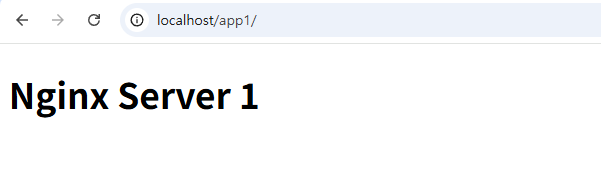
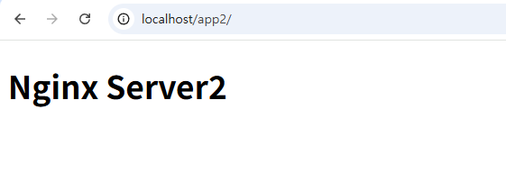
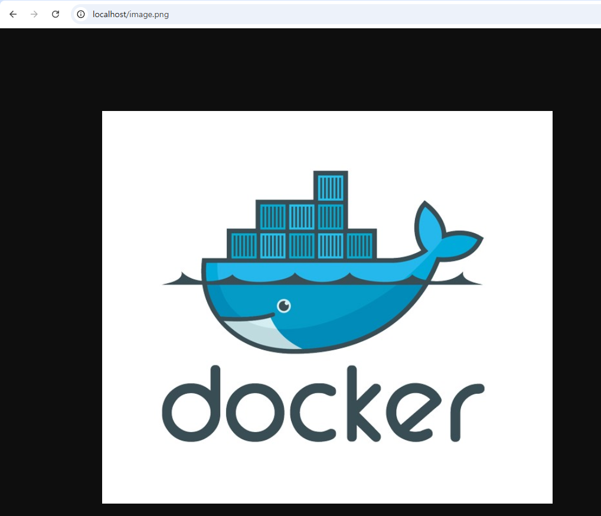
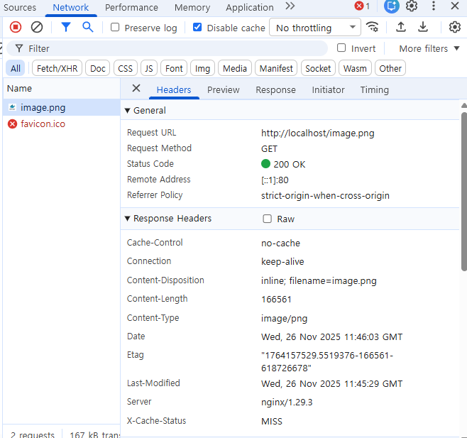
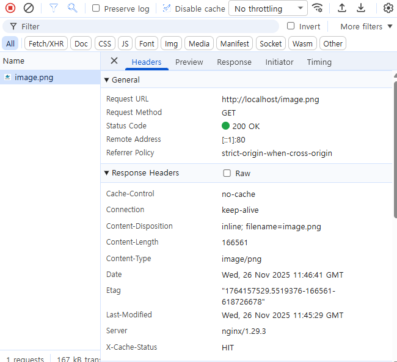
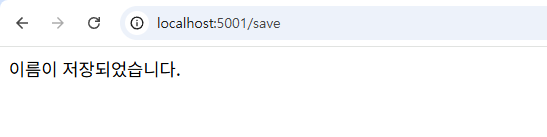
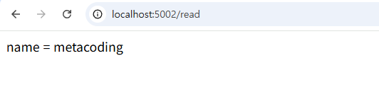
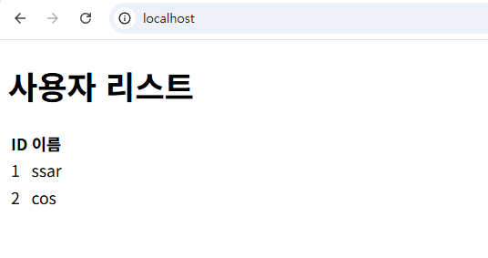

# 챕터 3. Docker 다루기

며칠 후, 화요일 오전 열 시. 회의실에 사람이 모였습니다. 팀장이 화이트보드 앞에 서서 이번에 만들 프로젝트를 설명했습니다. 사내에서 쓸 작은 서비스 하나를 새로 만든다는 이야기였습니다. 화면을 그릴 프론트엔드, 요청을 처리할 백엔드, 회원 정보를 보관할 DB가 함께 구성된 형태였습니다.

팀장이 펜을 내려놓고 오픈이 쪽을 봤습니다.

**팀장**: "환경은 Docker로 구성해봐요. 요즘 공부했잖아요."


*그림 3-1. 화이트보드에 그려진 프론트엔드·백엔드·DB 구성*

회의실을 나서는 발걸음이 가볍지 않았습니다. 컨테이너 하나를 실행하는 건 익혔지만, 여러 개를 한꺼번에 관리해 본 적은 없었습니다.

*'한 대씩은 실행해봤는데, 여러 대를 함께 구성하는 건 또 다른 이야기인데.'*

자리로 돌아온 오픈이가 옆자리 선배에게 물었습니다.

**오픈이**: "프론트엔드·백엔드·DB까지 구성해야 하는데, 어디서부터 손대야 할지 모르겠어요."

**선배**: "한꺼번에 다 하려니 막막한 거예요. 하나씩 하면 돼요. 먼저 매번 직접 세팅할 수는 없으니, 서비스마다 **필요한 걸 다 갖춘 환경을 미리 준비**해 둬요. 그리고 외부에서 요청을 받아 **적절한 컨테이너로 전달**하는 거죠. 마지막에 전체를 하나의 구성으로 합쳐 한 번에 실행하면 돼요."

<div class="svg-figure">
<svg viewBox="0 0 820 320" xmlns="http://www.w3.org/2000/svg" role="img" aria-label="챕터 3 한눈에 보기: 브라우저 요청을 NGINX(챕터 3.2)가 받아 백엔드 두 대에 분배하고, 두 백엔드는 데이터 그룹의 공용 Redis(챕터 3.3)와 DB(챕터 3.4)를 함께 사용한다. 전체는 Docker Compose(챕터 3.5)로 묶인다">
  <defs>
    <marker id="ov-req" markerWidth="8" markerHeight="8" refX="6" refY="3" orient="auto"><path d="M0,0 L0,6 L6,3 z" fill="#475569"/></marker>
    <marker id="ov-res" markerWidth="8" markerHeight="8" refX="6" refY="3" orient="auto"><path d="M0,0 L0,6 L6,3 z" fill="#94a3b8"/></marker>
  </defs>
  <text x="410" y="26" text-anchor="middle" font-size="16" font-weight="700" fill="#0f172a">챕터 3 한눈에 보기 — 전체 구조</text>
  <rect x="176" y="50" width="628" height="256" rx="12" fill="none" stroke="#475569" stroke-width="1.4" stroke-dasharray="6,4"/>
  <text x="192" y="70" font-size="11" font-weight="600" fill="#0f172a">Docker Compose 챕터 3.5</text>
  <rect x="28" y="162" width="104" height="52" rx="8" fill="#fff" stroke="#475569" stroke-width="1.8"/>
  <text x="80" y="193" text-anchor="middle" font-size="14" font-weight="700" fill="#0f172a">브라우저</text>
  <rect x="196" y="162" width="112" height="52" rx="8" fill="#fff" stroke="#475569" stroke-width="1.8"/>
  <text x="252" y="184" text-anchor="middle" font-size="14" font-weight="700" fill="#0f172a">NGINX</text>
  <text x="252" y="202" text-anchor="middle" font-size="10" font-weight="700" fill="#475569">챕터 3.2</text>
  <rect x="372" y="118" width="124" height="50" rx="8" fill="#fff" stroke="#475569" stroke-width="1.8"/>
  <text x="434" y="148" text-anchor="middle" font-size="14" font-weight="700" fill="#0f172a">백엔드1</text>
  <rect x="372" y="212" width="124" height="50" rx="8" fill="#fff" stroke="#475569" stroke-width="1.8"/>
  <text x="434" y="242" text-anchor="middle" font-size="14" font-weight="700" fill="#0f172a">백엔드2</text>
  <rect x="556" y="112" width="232" height="152" rx="8" fill="#f8fafc" stroke="#94a3b8" stroke-width="1.2" stroke-dasharray="3,2"/>
  <text x="574" y="130" font-size="10" font-style="italic" fill="#475569">데이터</text>
  <rect x="576" y="140" width="192" height="46" rx="8" fill="#fff4ed" stroke="#ff7849" stroke-width="1.6"/>
  <text x="672" y="158" text-anchor="middle" font-size="13" font-weight="700" fill="#7b341e">Redis</text>
  <text x="672" y="175" text-anchor="middle" font-size="10" font-weight="700" fill="#7b341e">챕터 3.3</text>
  <rect x="576" y="196" width="192" height="46" rx="8" fill="#fff4ed" stroke="#ff7849" stroke-width="1.6"/>
  <text x="672" y="214" text-anchor="middle" font-size="13" font-weight="700" fill="#7b341e">DB</text>
  <text x="672" y="231" text-anchor="middle" font-size="10" font-weight="700" fill="#7b341e">챕터 3.4</text>
  <line x1="132" y1="184" x2="194" y2="184" stroke="#475569" stroke-width="1.6" marker-end="url(#ov-req)"/>
  <line x1="194" y1="193" x2="134" y2="193" stroke="#94a3b8" stroke-width="1.4" stroke-dasharray="4,3" marker-end="url(#ov-res)"/>
  <line x1="308" y1="176" x2="370" y2="150" stroke="#475569" stroke-width="1.6" marker-end="url(#ov-req)"/>
  <line x1="370" y1="160" x2="308" y2="186" stroke="#94a3b8" stroke-width="1.4" stroke-dasharray="4,3" marker-end="url(#ov-res)"/>
  <line x1="308" y1="200" x2="370" y2="230" stroke="#475569" stroke-width="1.6" marker-end="url(#ov-req)"/>
  <line x1="370" y1="222" x2="308" y2="192" stroke="#94a3b8" stroke-width="1.4" stroke-dasharray="4,3" marker-end="url(#ov-res)"/>
  <line x1="496" y1="150" x2="554" y2="184" stroke="#475569" stroke-width="1.6" marker-end="url(#ov-req)"/>
  <line x1="554" y1="193" x2="498" y2="160" stroke="#94a3b8" stroke-width="1.4" stroke-dasharray="4,3" marker-end="url(#ov-res)"/>
  <line x1="496" y1="232" x2="554" y2="194" stroke="#475569" stroke-width="1.6" marker-end="url(#ov-req)"/>
  <line x1="554" y1="203" x2="498" y2="242" stroke="#94a3b8" stroke-width="1.4" stroke-dasharray="4,3" marker-end="url(#ov-res)"/>
</svg>
</div>

*그림 3-2. 챕터 3 한눈에 보기 - 전체 구조*

::::prep
**실습 준비**. 예제 코드

이 책의 실습 코드는 GitHub 레포 하나에 챕터별 폴더로 담겨 있습니다. 아래 명령으로 레포를 한 번 git clone 합니다. 이후 챕터마다 해당 폴더로 이동해 실습합니다.

```bash [터미널] 예제 코드 클론
git clone https://github.com/metacoding-10-linux-docker/start
```

이번 챕터는 `ex00`~`ex07` 폴더를 사용합니다.

완성된 코드는 아래 주소에서 확인하세요.

```bash [터미널] 완성 코드
https://github.com/metacoding-10-linux-docker/final
```
::::

## 3.1 Dockerfile - 환경을 자동으로 만들기

### 3.1.1 프로비저닝

앞에서 우리는 컨테이너 안으로 들어가 필요한 패키지와 환경을 직접 설치했습니다. 이 방법은 관리해야 할 컨테이너가 늘어날수록 일일이 설치하기 번거로워집니다. 밀키트를 한번 떠올려 보세요. 밀키트는 이미 재료와 레시피가 준비되어 있습니다. 그대로 조리하면 누가 만들어도 같은 요리가 나옵니다.

이런 방식이 도커에 이미 마련되어 있습니다. 필요한 환경을 파일 하나에 미리 정의해 두면, 컨테이너를 새로 만들 때 같은 작업을 반복하지 않아도 됩니다. 이렇게 환경을 미리 구성해 두는 작업을 **프로비저닝(Provisioning)** 이라고 부릅니다.

<div class="svg-figure">
<svg viewBox="0 0 720 360" xmlns="http://www.w3.org/2000/svg" role="img" aria-label="수동 세팅과 Dockerfile 자동화 비교">
  <defs>
    <marker id="ms31-p" markerWidth="10" markerHeight="10" refX="8" refY="3" orient="auto"><path d="M0,0 L0,6 L8,3 z" fill="#475569"/></marker>
    <marker id="ms31-o" markerWidth="10" markerHeight="10" refX="8" refY="3" orient="auto"><path d="M0,0 L0,6 L8,3 z" fill="#ff7849"/></marker>
  </defs>
  <text x="170" y="28" text-anchor="middle" font-size="14" font-weight="700" fill="#1f2937">수동 세팅</text>
  <text x="535" y="28" text-anchor="middle" font-size="14" font-weight="700" fill="#7b341e">프로비저닝</text>
  <line x1="350" y1="50" x2="350" y2="335" stroke="#cbd5e1" stroke-width="1.5" stroke-dasharray="6,4"/>
  <g transform="translate(135, 55)" fill="none" stroke="#475569" stroke-linecap="round" stroke-linejoin="round"><path d="M 10 10 L 4 3 L -2 3" stroke-width="1.8"/><path d="M 10 10 L 52 10 L 47 30 L 15 30 Z" stroke-width="1.8" fill="#fff"/><line x1="22" y1="10" x2="22" y2="30" stroke-width="0.8" opacity="0.5"/><line x1="31" y1="10" x2="31" y2="30" stroke-width="0.8" opacity="0.5"/><line x1="40" y1="10" x2="40" y2="30" stroke-width="0.8" opacity="0.5"/><rect x="22" y="2" width="6" height="10" rx="1" stroke-width="1.4" fill="#fff"/><circle cx="38" cy="6" r="4" stroke-width="1.4" fill="#fff"/><line x1="38" y1="2" x2="38" y2="0" stroke-width="1.2"/><circle cx="20" cy="35" r="3.2" stroke-width="1.5" fill="#fff"/><circle cx="40" cy="35" r="3.2" stroke-width="1.5" fill="#fff"/><circle cx="20" cy="35" r="0.8" fill="#475569" stroke="none"/><circle cx="40" cy="35" r="0.8" fill="#475569" stroke="none"/></g>
  <text x="170" y="118" text-anchor="middle" font-size="11" font-weight="600" fill="#0f172a">장보기</text>
  <g transform="translate(228, 145)" fill="none" stroke="#475569" stroke-linecap="round" stroke-linejoin="round"><rect x="2" y="22" width="58" height="18" rx="3" stroke-width="1.8" fill="#fff"/><line x1="10" y1="22" x2="10" y2="40" stroke-width="0.7" opacity="0.4"/><line x1="52" y1="22" x2="52" y2="40" stroke-width="0.7" opacity="0.4"/><rect x="2" y="6" width="11" height="10" rx="2" fill="#475569" stroke="none"/><path d="M 13 9 L 44 8 L 50 11 L 44 14 L 13 13 Z" stroke-width="1.5" fill="#fff"/><circle cx="14" cy="30" r="1.6" fill="#475569" stroke="none"/><circle cx="22" cy="33" r="1.6" fill="#475569" stroke="none"/><circle cx="30" cy="29" r="1.6" fill="#475569" stroke="none"/><circle cx="40" cy="32" r="1.6" fill="#475569" stroke="none"/><circle cx="48" cy="30" r="1.6" fill="#475569" stroke="none"/></g>
  <text x="260" y="215" text-anchor="middle" font-size="11" font-weight="600" fill="#0f172a">손질</text>
  <g transform="translate(135, 235)" fill="none" stroke="#475569" stroke-linecap="round" stroke-linejoin="round"><path d="M 22 10 Q 26 5 22 0 Q 19 -5 22 -10" stroke-width="1.3"/><path d="M 32 10 Q 36 5 32 0 Q 29 -5 32 -10" stroke-width="1.3"/><path d="M 42 10 Q 46 5 42 0 Q 39 -5 42 -10" stroke-width="1.3"/><rect x="3" y="11" width="56" height="5" rx="1" stroke-width="1.6" fill="#fff"/><rect x="27" y="7" width="8" height="4" rx="1" stroke-width="1.5" fill="#fff"/><path d="M 6 16 L 56 16 L 51 40 L 11 40 Z" stroke-width="1.8" fill="#fff"/><path d="M -3 21 L 6 21 L 6 28 L -3 28" stroke-width="1.5"/><path d="M 65 21 L 56 21 L 56 28 L 65 28" stroke-width="1.5"/></g>
  <text x="167" y="295" text-anchor="middle" font-size="11" font-weight="600" fill="#0f172a">조리</text>
  <g transform="translate(40, 145)" fill="none" stroke="#475569" stroke-linecap="round" stroke-linejoin="round"><rect x="14" y="3" width="22" height="6" rx="1" stroke-width="1.6" fill="#fff"/><circle cx="20" cy="6" r="0.8" fill="#475569" stroke="none"/><circle cx="25" cy="6" r="0.8" fill="#475569" stroke="none"/><circle cx="30" cy="6" r="0.8" fill="#475569" stroke="none"/><rect x="11" y="9" width="28" height="28" rx="2" stroke-width="1.8" fill="#fff"/><line x1="11" y1="22" x2="39" y2="22" stroke-width="1.2"/><text x="25" y="32" text-anchor="middle" font-size="6" font-weight="700" fill="#475569" stroke="none">SALT</text><circle cx="44" cy="13" r="1" fill="#475569" stroke="none"/><circle cx="48" cy="17" r="1" fill="#475569" stroke="none"/><circle cx="50" cy="22" r="1" fill="#475569" stroke="none"/><circle cx="48" cy="27" r="1" fill="#475569" stroke="none"/><circle cx="44" cy="31" r="1" fill="#475569" stroke="none"/></g>
  <text x="65" y="215" text-anchor="middle" font-size="11" font-weight="600" fill="#0f172a">양념</text>
  <text x="170" y="178" text-anchor="middle" font-size="13" font-weight="700" fill="#1f2937">매번 반복</text>
  <text x="170" y="194" text-anchor="middle" font-size="10" fill="#6b7280">손이 많이 갑니다</text>
  <path d="M 200 90 Q 250 90 250 150" fill="none" stroke="#475569" stroke-width="1.5" marker-end="url(#ms31-p)"/>
  <path d="M 250 200 Q 250 260 200 260" fill="none" stroke="#475569" stroke-width="1.5" marker-end="url(#ms31-p)"/>
  <path d="M 140 260 Q 90 260 90 200" fill="none" stroke="#475569" stroke-width="1.5" marker-end="url(#ms31-p)"/>
  <path d="M 90 150 Q 90 90 140 90" fill="none" stroke="#475569" stroke-width="1.5" marker-end="url(#ms31-p)"/>
  <g transform="translate(385, 130)" stroke="#ff7849" stroke-linecap="round" stroke-linejoin="round"><path d="M 5 22 L 95 22 L 95 90 L 5 90 Z" fill="#fff4ed" stroke-width="1.8"/><path d="M 5 22 L 25 5 L 75 5 L 95 22" fill="#fff4ed" stroke-width="1.8"/><line x1="50" y1="22" x2="50" y2="5" stroke-width="1.0" stroke-dasharray="2,2"/><rect x="18" y="42" width="64" height="32" rx="3" fill="#fff" stroke-width="1.3"/><text x="50" y="56" text-anchor="middle" font-size="10" font-weight="700" fill="#7b341e" stroke="none">MEAL</text><text x="50" y="68" text-anchor="middle" font-size="10" font-weight="700" fill="#7b341e" stroke="none">KIT</text></g>
  <text x="435" y="240" text-anchor="middle" font-size="13" font-weight="700" fill="#7b341e">밀키트</text>
  <line x1="497" y1="175" x2="555" y2="175" stroke="#ff7849" stroke-width="1.8" marker-end="url(#ms31-o)"/>
  <g transform="translate(560, 145)" stroke="#475569" stroke-linecap="round" stroke-linejoin="round"><path d="M 45 18 Q 48 12 45 6" stroke-width="1.1" fill="none" stroke-dasharray="2,2"/><path d="M 60 14 Q 63 8 60 2" stroke-width="1.1" fill="none" stroke-dasharray="2,2"/><path d="M 75 18 Q 78 12 75 6" stroke-width="1.1" fill="none" stroke-dasharray="2,2"/><ellipse cx="60" cy="38" rx="55" ry="16" fill="#fff" stroke-width="1.8"/><ellipse cx="60" cy="38" rx="44" ry="11" fill="#fff" stroke-width="1.5"/><path d="M 28 38 Q 40 30 50 38 Q 60 30 70 38 Q 80 30 90 36" fill="none" stroke-width="1.3"/><path d="M 30 42 Q 45 34 60 42 Q 75 32 88 40" fill="none" stroke-width="1.3"/><path d="M 35 45 Q 50 38 65 45 Q 78 38 86 44" fill="none" stroke-width="1.3"/><circle cx="60" cy="34" r="4.5" fill="#fff4ed" stroke="#ff7849" stroke-width="1.3"/><path d="M 58 30 Q 60 28 62 30" stroke="#ff7849" stroke-width="1.0" fill="none"/></g>
  <text x="620" y="240" text-anchor="middle" font-size="13" font-weight="700" fill="#0f172a">완성된 요리</text>
  <text x="535" y="298" text-anchor="middle" font-size="13" font-weight="700" fill="#7b341e">조리만 하면 끝</text>
  <text x="535" y="316" text-anchor="middle" font-size="10" fill="#6b7280">한 번 작성하면 어디서나 같은 결과</text>
</svg>
</div>

*그림 3-3. 수동 세팅과 프로비저닝 비교*

도커에서 이 프로비저닝을 담당하는 정의 파일이 바로 **Dockerfile**입니다. 밀키트처럼 필요한 설정을 한 번 적어 두면, 도커가 그대로 따라 같은 이미지를 자동으로 만들어 줍니다.

### 3.1.2 Dockerfile에서 컨테이너까지의 세 단계

**Dockerfile**은 이미지를 만드는 데 필요한 환경 구성을 담은 스크립트입니다. 베이스 이미지, 설치할 패키지, 복사할 파일, 실행할 명령을 순서대로 적어 두면, 그 내용대로 컨테이너가 만들어집니다.

Dockerfile에서 컨테이너로 실행되기까지 크게 세 단계를 거칩니다.

<div class="svg-figure">
<svg viewBox="0 0 720 220" xmlns="http://www.w3.org/2000/svg" role="img" aria-label="Dockerfile에서 컨테이너까지 세 단계">
  <defs>
    <marker id="rr32" markerWidth="10" markerHeight="10" refX="8" refY="3" orient="auto"><path d="M0,0 L0,6 L8,3 z" fill="#475569"/></marker>
  </defs>
  <text x="360" y="22" text-anchor="middle" font-size="13" font-weight="700" fill="#1f2937">Dockerfile에서 컨테이너까지 — 세 단계</text>
  <g transform="translate(85, 65)" stroke="#475569" fill="none" stroke-linecap="round" stroke-linejoin="round"><path d="M 0 0 L 35 0 L 50 15 L 50 60 L 0 60 Z" stroke-width="1.8" fill="#fff"/><path d="M 35 0 L 35 15 L 50 15" stroke-width="1.8" fill="#fff"/><line x1="8" y1="28" x2="42" y2="28" stroke-width="1.4"/><line x1="8" y1="36" x2="42" y2="36" stroke-width="1.4"/><line x1="8" y1="44" x2="42" y2="44" stroke-width="1.4"/><line x1="8" y1="52" x2="32" y2="52" stroke-width="1.4"/></g>
  <text x="110" y="148" text-anchor="middle" font-size="13" font-weight="700" fill="#0f172a">Dockerfile</text>
  <text x="110" y="166" text-anchor="middle" font-size="11" fill="#6b7280">환경 구성 스크립트</text>
  <line x1="148" y1="95" x2="305" y2="95" stroke="#475569" stroke-width="1.6" marker-end="url(#rr32)"/>
  <text x="226" y="86" text-anchor="middle" font-size="11" font-weight="700" font-family="monospace" fill="#0f172a">docker build</text>
  <g transform="translate(310, 65)" stroke="#475569" fill="none" stroke-linecap="round" stroke-linejoin="round"><rect x="0" y="0" width="72" height="60" rx="4" stroke-width="1.8" fill="#fff"/><circle cx="16" cy="16" r="5" stroke-width="1.5" fill="#fff"/><path d="M 4 48 L 22 22 L 34 34 L 50 18 L 68 48 Z" stroke-width="1.5" fill="#fff"/><line x1="0" y1="48" x2="72" y2="48" stroke-width="1.3"/></g>
  <text x="346" y="148" text-anchor="middle" font-size="13" font-weight="700" fill="#0f172a">이미지</text>
  <text x="344" y="166" text-anchor="middle" font-size="11" fill="#6b7280">실행 가능한 환경 스냅샷</text>
  <line x1="395" y1="95" x2="555" y2="95" stroke="#475569" stroke-width="1.6" marker-end="url(#rr32)"/>
  <text x="475" y="86" text-anchor="middle" font-size="11" font-weight="700" font-family="monospace" fill="#0f172a">docker run</text>
  <g transform="translate(570, 70)" stroke="#ff7849" fill="none" stroke-linecap="round" stroke-linejoin="round"><path d="M 0 12 L 18 0 L 68 0 L 50 12 Z" stroke-width="1.8" fill="#fff4ed"/><path d="M 50 12 L 68 0 L 68 40 L 50 52 Z" stroke-width="1.8" fill="#fff4ed"/><rect x="0" y="12" width="50" height="40" stroke-width="1.8" fill="#fff4ed"/><line x1="10" y1="14" x2="10" y2="50" stroke-width="1.2"/><line x1="20" y1="14" x2="20" y2="50" stroke-width="1.2"/><line x1="30" y1="14" x2="30" y2="50" stroke-width="1.2"/><line x1="40" y1="14" x2="40" y2="50" stroke-width="1.2"/></g>
  <text x="604" y="148" text-anchor="middle" font-size="13" font-weight="700" fill="#7b341e">컨테이너</text>
  <text x="604" y="166" text-anchor="middle" font-size="11" fill="#7b341e">실제 실행 인스턴스</text>
  <text x="360" y="205" text-anchor="middle" font-size="10" fill="#6b7280">컨테이너를 지워도 이미지는 남아 있어 같은 환경을 다시 실행할 수 있습니다</text>
</svg>
</div>

*그림 3-4. Dockerfile → 이미지 → 컨테이너의 세 단계*

1. **Dockerfile 작성**: 구축하고 싶은 환경을 텍스트 파일에 차례대로 적습니다.
2. **docker build**: 도커 엔진이 Dockerfile에 적힌 명령을 순서대로 처리합니다. 이 과정이 끝나면 결과물이 이미지로 저장됩니다.
3. **docker run**: 생성된 이미지를 기반으로 실제 컨테이너를 실행합니다.

*'그러면 이 Dockerfile에 뭘 어떻게 적느냐가 핵심이겠네.'*

### 3.1.3 Dockerfile 기본 문법

Dockerfile에서 가장 자주 쓰이는 지시어를 표로 정리하면 다음과 같습니다.

|    지시어    | 역할                                                         |
| :----------: | :----------------------------------------------------------- |
|    `FROM`    | 베이스 이미지를 지정합니다. (어떤 환경에서 시작할지)         |
|  `WORKDIR`   | 컨테이너 내부에서 명령이 실행될 기본 디렉토리를 지정합니다.  |
|    `COPY`    | 호스트 컴퓨터의 파일을 컨테이너 안으로 복사합니다.           |
|    `RUN`     | 이미지를 빌드하는 동안 실행할 명령어입니다. (패키지 설치 등) |
|    `ENV`     | 컨테이너 안에서 사용할 환경 변수를 설정합니다.               |
|    `CMD`     | 컨테이너 시작 시 실행할 기본 명령어입니다.                   |
| `ENTRYPOINT` | 컨테이너 시작 시 반드시 실행되는 메인 프로세스입니다.        |

첫 실습으로 Ubuntu 환경에 vim이 미리 설치된 이미지를 만들어 보겠습니다. 실습 코드는 클론한 레포의 `ex00` 폴더에 있습니다.

`Dockerfile`을 열어 다음 내용을 작성합니다.

```dockerfile [실습 1] ex00/Dockerfile. ubuntu-vim 이미지 정의
# Dockerfile
FROM ubuntu:24.04                      # 베이스 이미지
RUN apt update && apt install -y vim   # vim 패키지 설치
CMD ["/bin/bash"]                      # 컨테이너 시작 시 bash 실행
```

파일을 저장하고 빌드 명령을 입력합니다.

```bash [터미널] ubuntu-vim 이미지 빌드와 컨테이너 실행
docker build -t ubuntu-vim ex00   # ex00 폴더의 Dockerfile로 이미지 빌드
docker run -it ubuntu-vim                     # 빌드한 이미지로 컨테이너 실행
```

빌드가 끝나면 이미지가 완성됩니다. 이 이미지로 컨테이너를 실행하고 vim을 입력하면, 별도의 설치 과정 없이 편집기가 그대로 뜹니다.

<div class="terminal-log">
  <div class="tl-chrome">
    <div class="tl-traffic"><span></span><span></span><span></span></div>
    <div class="tl-title">실행결과</div>
    <div class="tl-spacer"></div>
  </div>
  <div class="tl-body">
    <div><span class="tl-key">$</span> <span class="tl-str">docker run -it ubuntu-vim</span></div>
    <div><span class="tl-key">root@a1b2c3d4e5f6:/#</span> <span class="tl-str">vim</span></div>
    <div>~</div>
    <div>~</div>
    <div>~</div>
    <div>:q!</div>
  </div>
</div>

*그림 3-5. 컨테이너에 들어가 vim을 실행한 결과*

### 3.1.4 WORKDIR와 COPY

다음으로 로컬에 있는 파일을 컨테이너 내부로 옮겨보겠습니다. 여기에 쓰는 지시어가 **WORKDIR**와 **COPY**입니다.

Dockerfile과 같은 폴더에 `index.html`이 들어 있습니다. 작업 디렉토리를 `/app`으로 정하는 `WORKDIR`와, 그 안으로 index.html을 복사하는 `COPY` 두 줄을 추가합니다.

```dockerfile [실습 2] ex00/Dockerfile. WORKDIR과 COPY 추가
FROM ubuntu:24.04                      # 베이스 이미지
WORKDIR /app                           # 작업 디렉토리 설정
COPY ./index.html ./index.html         # 로컬의 index.html을 컨테이너의 /app으로 복사
RUN apt update && apt install -y vim   # vim 패키지 설치
CMD ["/bin/bash"]                      # 컨테이너 시작 시 bash 실행
```

수정한 Dockerfile로 이미지를 다시 만들어 실행합니다.

```bash [터미널] ubuntu-html 이미지 빌드와 실행
docker build -t ubuntu-html ex00   # ex00 폴더의 Dockerfile로 이미지 빌드
docker run -it ubuntu-html       # 컨테이너 실행
ls
```

<div class="terminal-log">
  <div class="tl-chrome">
    <div class="tl-traffic"><span></span><span></span><span></span></div>
    <div class="tl-title">실행결과</div>
    <div class="tl-spacer"></div>
  </div>
  <div class="tl-body">
    <div><span class="tl-key">$</span> <span class="tl-str">docker run -it ubuntu-html</span></div>
    <div><span class="tl-key">root@5497d6efff3c:/app#</span> <span class="tl-str">ls</span></div>
    <div>index.html</div>
  </div>
</div>

*그림 3-6. 실행 결과 확인*

터미널 프롬프트가 처음부터 `/app`을 가리키고, 그 안에 index.html이 들어 있습니다.

### 3.1.5 CMD와 ENTRYPOINT

CMD와 ENTRYPOINT는 둘 다 컨테이너가 시작될 때 무엇을 실행할지 정하는 지시어입니다. CMD는 **실행할 때 다른 명령으로 바꿀 수 있는 기본 프로세스**이고, ENTRYPOINT는 **반드시 실행되는 메인 프로세스**입니다.

커피 머신을 떠올리면 이해하기 쉽습니다. ENTRYPOINT는 **커피를 내린다는 동작 자체**라, 어떤 메뉴를 선택하든 반드시 실행됩니다. 반면 CMD는 따로 옵션을 선택하지 않으면 **기본 메뉴인 아메리카노**가 나오고, 라떼를 선택하면 라떼가 나옵니다. 즉 기본값이 쓰이되, 실행할 때 다른 값을 주면 그 값으로 바뀝니다.

실습을 위해 Dockerfile에 ENTRYPOINT를 추가합니다.

```dockerfile [실습 3] ex00/Dockerfile. ENTRYPOINT로 자동 실행
FROM ubuntu:24.04                      # 베이스 이미지
WORKDIR /app                           # 작업 디렉토리 설정
COPY ./index.html ./index.html         # 로컬의 index.html을 컨테이너의 /app으로 복사
RUN apt update && apt install -y vim   # vim 패키지 설치
CMD ["/bin/bash"]                      # ubuntu의 기본 프로세스
ENTRYPOINT ["echo", "컨테이너 실행"]     # 컨테이너 시작 시 echo 실행
```

이미지를 다시 빌드하고 컨테이너를 실행합니다.

```bash [터미널] ubuntu-entry 이미지 빌드와 실행
docker build -t ubuntu-entry ex00   # ex00 폴더의 Dockerfile로 이미지 빌드
docker run -it ubuntu-entry                    # 컨테이너 실행
```

<div class="terminal-log">
  <div class="tl-chrome">
    <div class="tl-traffic"><span></span><span></span><span></span></div>
    <div class="tl-title">실행결과</div>
    <div class="tl-spacer"></div>
  </div>
  <div class="tl-body">
    <div><span class="tl-key">$</span> <span class="tl-str">docker build -t ubuntu-entry ex00</span></div>
    <div>#7 naming to docker.io/library/ubuntu-entry:latest done</div>
    <div>#7 DONE 0.3s</div>
    <div><span class="tl-key">$</span> <span class="tl-str">docker run -it ubuntu-entry</span></div>
    <div>컨테이너 실행 /bin/bash</div>
  </div>
</div>

*그림 3-7. ENTRYPOINT 실행 결과*

ENTRYPOINT의 `echo "컨테이너 실행"` 뒤에 CMD의 `/bin/bash`가 인자로 붙어 함께 출력됩니다. CMD만 있을 때는 **CMD가 메인 프로세스**가 되지만, ENTRYPOINT와 함께 쓰이면 ENTRYPOINT가 메인 프로세스로 실행되고 CMD의 값은 실행되지 않은 채 **그 인자(Argument)로 전달**됩니다.

*'이렇게 환경을 미리 설정해 두면, 매번 명령을 실행할 필요 없이 관리할 수 있구나.'*

## 3.2 NGINX - 요청을 앞에서 받아 나눠주기

앞에서 Dockerfile로 컨테이너 하나를 만들어 실행해 봤습니다. 그런데 실제 서비스는 컨테이너 하나로 끝나지 않습니다. 여러 컨테이너가 함께 돌아가고, 들어오는 요청마다 처리해야 할 컨테이너가 다릅니다.

*'들어온 요청을 알맞은 컨테이너로 보내려면 어떻게 해야 할까.'*

### 3.2.1 NGINX의 역할

이 역할을 맡는 도구가 **NGINX**입니다. NGINX는 들어온 요청을 받아, 그 요청을 처리할 알맞은 컨테이너로 전달합니다.

<div class="svg-figure">
<svg viewBox="0 0 720 320" xmlns="http://www.w3.org/2000/svg" role="img" aria-label="NGINX가 서버 영역을 대표해 요청을 받는 리버스 프록시 구조">
  <defs>
    <marker id="rr38" markerWidth="10" markerHeight="10" refX="8" refY="3" orient="auto"><path d="M0,0 L0,6 L8,3 z" fill="#475569"/></marker>
  </defs>
  <text x="360" y="22" text-anchor="middle" font-size="13" font-weight="700" fill="#1f2937">리버스 프록시 — NGINX가 서버 영역을 대표해 요청을 받는다</text>
  <rect x="20" y="130" width="110" height="60" rx="8" fill="#fff" stroke="#475569" stroke-width="1.8"/>
  <text x="75" y="155" text-anchor="middle" font-size="13" font-weight="700" fill="#0f172a">클라이언트</text>
  <text x="75" y="175" text-anchor="middle" font-size="11" fill="#6b7280">NGINX만 본다</text>
  <line x1="130" y1="160" x2="193" y2="160" stroke="#475569" stroke-width="1.6" marker-end="url(#rr38)"/>
  <text x="161" y="151" text-anchor="middle" font-size="11" font-weight="600" fill="#0f172a">요청</text>
  <rect x="165" y="60" width="540" height="225" rx="10" fill="none" stroke="#475569" stroke-width="1.5" stroke-dasharray="6,4"/>
  <rect x="200" y="130" width="130" height="60" rx="8" fill="#fff4ed" stroke="#ff7849" stroke-width="1.8"/>
  <text x="265" y="155" text-anchor="middle" font-size="13" font-weight="700" fill="#7b341e">NGINX</text>
  <text x="265" y="175" text-anchor="middle" font-size="11" fill="#7b341e">리버스 프록시</text>
  <rect x="520" y="85" width="150" height="48" rx="8" fill="#fff" stroke="#475569" stroke-width="1.8"/>
  <text x="595" y="114" text-anchor="middle" font-size="12" font-weight="700" fill="#0f172a">서버 1</text>
  <rect x="520" y="153" width="150" height="48" rx="8" fill="#fff" stroke="#475569" stroke-width="1.8"/>
  <text x="595" y="182" text-anchor="middle" font-size="12" font-weight="700" fill="#0f172a">서버 2</text>
  <rect x="520" y="221" width="150" height="48" rx="8" fill="#fff" stroke="#475569" stroke-width="1.8"/>
  <text x="595" y="250" text-anchor="middle" font-size="12" font-weight="700" fill="#0f172a">서버 3</text>
  <line x1="330" y1="158" x2="515" y2="109" stroke="#475569" stroke-width="1.6" marker-end="url(#rr38)"/>
  <line x1="330" y1="160" x2="515" y2="177" stroke="#475569" stroke-width="1.6" marker-end="url(#rr38)"/>
  <line x1="330" y1="162" x2="515" y2="245" stroke="#475569" stroke-width="1.6" marker-end="url(#rr38)"/>
  <text x="360" y="305" text-anchor="middle" font-size="10" fill="#6b7280">클라이언트는 NGINX만 마주하고, 그 뒤의 실제 서버 구성은 드러나지 않습니다</text>
</svg>
</div>

*그림 3-8. 클라이언트에게는 NGINX 하나로 보이는 서버 영역*

:::tip
NGINX는 가볍고 빠른 오픈소스 웹 서버이자 **리버스 프록시(Reverse Proxy)** 입니다. 리버스 프록시는 클라이언트의 요청을 대신 받아 알맞은 뒤쪽 서버로 넘겨주는 중계 역할을 합니다. 이 구조 덕분에 클라이언트에게는 NGINX만 보여 내부 서버의 보안이 유지됩니다. 요청 전달 외에도 여러 서버로 트래픽을 분산시키는 로드 밸런싱이나 캐싱 등 트래픽 관리에도 사용됩니다.
:::

### 3.2.2 NGINX 설정과 요청 흐름

NGINX는 전국의 택배가 모이는 대형 분류 센터처럼 동작합니다. 전국에서 들어온 택배가 한곳에 모였다가, 주소지에 따라 알맞은 지역 센터로 나뉘어 나갑니다. NGINX의 설정도 같은 방식으로 요청을 나눠 보냅니다.

- **upstream (서버 그룹 정의)** : 특정 지역을 담당할 **배송 센터(서버 그룹)** 로 모아 이름을 붙이는 작업입니다. 물건을 넘겨줄 목적지를 미리 등록해 둡니다.
- **location (요청 경로 매칭)** : 택배의 **주소지(URL)를 확인**하고 분류하는 게이트입니다. 주소를 확인해 최종 행선지를 결정합니다.
- **proxy_pass (요청 전달)** : 분류된 택배를 **지정된 물류 센터로 이동**시키는 지시어입니다. **"이 물품은 서울 센터로 보내"** 라는 최종 명령입니다.

<div class="svg-figure">
<svg viewBox="0 0 720 300" xmlns="http://www.w3.org/2000/svg" role="img" aria-label="택배 분류 센터에 빗댄 NGINX 설정 — 주소 확인 후 지정 센터로 분류">
  <defs>
    <marker id="nx10a" markerWidth="10" markerHeight="10" refX="8" refY="3" orient="auto"><path d="M0,0 L0,6 L8,3 z" fill="#475569"/></marker>
    <marker id="nx10b" markerWidth="10" markerHeight="10" refX="8" refY="3" orient="auto"><path d="M0,0 L0,6 L8,3 z" fill="#ff7849"/></marker>
  </defs>
  <text x="360" y="26" text-anchor="middle" font-size="13" font-weight="700" fill="#1f2937">택배 분류 센터처럼 — 주소를 확인해 알맞은 센터로 보낸다</text>
  <g transform="translate(40,120)" stroke="#475569" fill="none" stroke-linejoin="round">
    <path d="M0 16 L36 3 L72 16 L72 58 L0 58 Z" fill="#fff" stroke-width="1.8"/>
    <path d="M0 16 L36 3 L72 16 L36 29 Z" fill="#f1f5f9" stroke-width="1.4"/>
    <line x1="36" y1="29" x2="36" y2="58" stroke-width="1"/>
    <rect x="18" y="36" width="36" height="15" fill="#fff" stroke-width="1.2"/>
    <text x="36" y="47" text-anchor="middle" font-size="9" fill="#6b7280" stroke="none">주소?</text>
  </g>
  <text x="76" y="200" text-anchor="middle" font-size="11" font-weight="600" fill="#0f172a">택배(요청) 도착</text>
  <line x1="116" y1="150" x2="158" y2="150" stroke="#475569" stroke-width="1.6" marker-end="url(#nx10a)"/>
  <g transform="translate(178,122)" stroke="#ff7849" fill="none" stroke-width="2.2" stroke-linecap="round">
    <circle cx="26" cy="26" r="24" fill="#fff4ed"/>
    <line x1="43" y1="43" x2="60" y2="60"/>
    <path d="M16 26 L24 33 L37 19" stroke-width="2"/>
  </g>
  <text x="204" y="200" text-anchor="middle" font-size="12" font-weight="700" font-family="monospace" fill="#7b341e">location</text>
  <text x="204" y="216" text-anchor="middle" font-size="10" fill="#6b7280">주소(URL) 확인</text>
  <line x1="246" y1="148" x2="548" y2="110" stroke="#ff7849" stroke-width="1.8" marker-end="url(#nx10b)"/>
  <text x="378" y="100" text-anchor="middle" font-size="11" font-weight="700" font-family="monospace" fill="#7b341e">proxy_pass</text>
  <text x="378" y="116" text-anchor="middle" font-size="11" fill="#475569">지정 센터로 전달</text>
  <rect x="512" y="42" width="180" height="226" rx="10" fill="none" stroke="#475569" stroke-width="1.4" stroke-dasharray="6,4"/>
  <text x="602" y="62" text-anchor="middle" font-size="11" font-weight="700" font-family="monospace" fill="#475569">upstream</text>
  <g transform="translate(564,70)" stroke="#475569" fill="none" stroke-linejoin="round">
    <path d="M0 24 L38 2 L76 24 Z" fill="#fff4ed" stroke-width="1.6"/>
    <rect x="8" y="24" width="60" height="42" fill="#fff" stroke-width="1.6"/>
    <rect x="30" y="44" width="16" height="22" fill="#fff" stroke-width="1.2"/>
  </g>
  <text x="602" y="156" text-anchor="middle" font-size="11" font-weight="600" fill="#0f172a">서울 센터</text>
  <g transform="translate(564,170)" stroke="#475569" fill="none" stroke-linejoin="round">
    <path d="M0 24 L38 2 L76 24 Z" fill="#fff4ed" stroke-width="1.6"/>
    <rect x="8" y="24" width="60" height="42" fill="#fff" stroke-width="1.6"/>
    <rect x="30" y="44" width="16" height="22" fill="#fff" stroke-width="1.2"/>
  </g>
  <text x="602" y="256" text-anchor="middle" font-size="11" font-weight="600" fill="#0f172a">부산 센터</text>
</svg>
</div>

*그림 3-9. 주소를 확인해(location) 지정 센터로 보내는(proxy_pass) NGINX 설정의 흐름*

이 옵션을 포함한 다양한 설정을 `nginx.conf` 파일에 작성합니다. 옵션 조합에 따라 라우팅이나 로드밸런싱 같은 다양한 역할을 수행할 수 있습니다.

### 3.2.3 경로 기반 라우팅

먼저 해볼 실습은 요청 경로에 따른 라우팅입니다. `/app1`로 들어오면 1번 서버, `/app2`로 들어오면 2번 서버로 보냅니다.

<div class="svg-figure">
<svg viewBox="0 0 720 280" xmlns="http://www.w3.org/2000/svg" role="img" aria-label="경로 기반 라우팅 구조">
  <defs>
    <marker id="rr39" markerWidth="10" markerHeight="10" refX="8" refY="3" orient="auto"><path d="M0,0 L0,6 L8,3 z" fill="#475569"/></marker>
  </defs>
  <text x="360" y="22" text-anchor="middle" font-size="13" font-weight="700" fill="#1f2937">경로 기반 라우팅 — URL에 따라 다른 서버로</text>
  <rect x="20" y="115" width="140" height="60" rx="8" fill="#fff" stroke="#475569" stroke-width="1.8"/>
  <text x="90" y="140" text-anchor="middle" font-size="13" font-weight="700" fill="#0f172a">클라이언트</text>
  <text x="90" y="160" text-anchor="middle" font-size="11" fill="#6b7280">요청 발송</text>
  <line x1="160" y1="145" x2="280" y2="145" stroke="#475569" stroke-width="1.6" marker-end="url(#rr39)"/>
  <text x="220" y="136" text-anchor="middle" font-size="11" font-weight="600" fill="#0f172a">요청</text>
  <rect x="262" y="28" width="448" height="237" rx="10" fill="none" stroke="#475569" stroke-width="1.5" stroke-dasharray="6,4"/>
  <rect x="280" y="115" width="140" height="60" rx="8" fill="#fff4ed" stroke="#ff7849" stroke-width="1.8"/>
  <text x="350" y="140" text-anchor="middle" font-size="13" font-weight="700" fill="#7b341e">NGINX</text>
  <text x="350" y="160" text-anchor="middle" font-size="11" fill="#7b341e">URL 경로 분류</text>
  <line x1="420" y1="128" x2="540" y2="65" stroke="#475569" stroke-width="1.6" marker-end="url(#rr39)"/>
  <text x="478" y="88" text-anchor="middle" font-size="11" font-weight="600" fill="#0f172a">/app1 경로</text>
  <line x1="420" y1="162" x2="540" y2="225" stroke="#475569" stroke-width="1.6" marker-end="url(#rr39)"/>
  <text x="478" y="208" text-anchor="middle" font-size="11" font-weight="600" fill="#0f172a">/app2 경로</text>
  <rect x="540" y="35" width="160" height="60" rx="8" fill="#fff" stroke="#475569" stroke-width="1.8"/>
  <text x="620" y="60" text-anchor="middle" font-size="13" font-weight="700" fill="#0f172a">서버 1</text>
  <text x="620" y="80" text-anchor="middle" font-size="11" fill="#6b7280">app1 페이지 응답</text>
  <rect x="540" y="195" width="160" height="60" rx="8" fill="#fff" stroke="#475569" stroke-width="1.8"/>
  <text x="620" y="220" text-anchor="middle" font-size="13" font-weight="700" fill="#0f172a">서버 2</text>
  <text x="620" y="240" text-anchor="middle" font-size="11" fill="#6b7280">app2 페이지 응답</text>
</svg>
</div>

*그림 3-10. 경로 기반 라우팅 구조*

실습 코드는 `ex01` 폴더에 있습니다. 컨테이너로 실행할 단위는 화면을 담당하는 `app1`·`app2`와 그 앞에서 경로를 분기하는 `lb`입니다. 각 폴더에는 Dockerfile이 있습니다.

```text
ex01/
├── app1/
│   ├── Dockerfile       # nginx 이미지 + index.html 복사
│   └── index.html       # app1 페이지
├── app2/
│   ├── Dockerfile       # nginx 이미지 + index.html 복사
│   └── index.html       # app2 페이지
├── lb/
│   ├── Dockerfile       # nginx 이미지 + nginx.conf 복사
│   └── nginx.conf       # 경로 라우팅 설정
└── README.md            # 실습 안내
```

핵심은 `lb` 폴더의 `nginx.conf` 파일입니다. 경로별로 어느 서버 그룹으로 보낼지 적는 파일입니다.

```nginx [참고] ex01/lb/nginx.conf. 경로 라우팅 설정
upstream app1 {                           # app1 그룹 지정
    server host.docker.internal:8000;     # 호스트의 8000번 포트 = app1 컨테이너
}

upstream app2 {                           # app2 그룹 지정
    server host.docker.internal:9000;     # 호스트의 9000번 포트 = app2 컨테이너
}

server {
    listen 80;

    location /app1 {                      # /app1 주소로 오는 요청 분류
        proxy_pass http://app1/;          # upstream의 app1 그룹으로 전달
    }

    location /app2 {                      # /app2 주소로 오는 요청 분류
        proxy_pass http://app2/;          # upstream의 app2 그룹으로 전달
    }
}
```

이제 이 설정 파일을 포함한 이미지가 필요합니다. `lb` 폴더의 Dockerfile로 만듭니다.

```dockerfile [실습 4] ex01/lb/Dockerfile. NGINX 라우터 이미지
FROM nginx                                          # NGINX 공식 이미지 사용
COPY nginx.conf /etc/nginx/conf.d/default.conf      # 작성한 설정 파일을 기본 경로에 복사
ENTRYPOINT ["nginx", "-g", "daemon off;"]           # NGINX를 포그라운드로 실행
```

세 폴더가 준비되면 차례로 빌드하고 실행합니다.

```bash [터미널] app1·app2·lb 빌드와 실행
# app1: 이미지 빌드 + 호스트 8000 → 컨테이너 80
docker build -t app1 ex01/app1
docker run -dit -p 8000:80 app1

# app2: 이미지 빌드 + 호스트 9000 → 컨테이너 80
docker build -t app2 ex01/app2
docker run -dit -p 9000:80 app2

# lb: 이미지 빌드 + 호스트 80 → 컨테이너 80
docker build -t lb ex01/lb
docker run -dit -p 80:80 lb
```

브라우저 주소창에 `localhost:80/app1`을 입력하면 1번 서버의 화면이 뜹니다. 주소를 `/app2`로 바꾸면 이번에는 2번 서버 화면이 나타납니다.



*그림 3-11. /app1 경로로 접속한 결과*



*그림 3-12. /app2 경로로 접속한 결과*

포트 충돌이 발생할 수 있으니, 각 예제 실습 후에 다음 명령어를 실행해 실행 중인 컨테이너를 종료합니다.

```bash [터미널] 실행 중인 컨테이너 전체 종료
docker stop $(docker ps -q)   # 실행 중인 모든 컨테이너 종료
```

### 3.2.4 host.docker.internal과 사용자 정의 네트워크

#### host.docker.internal이 왜 필요한가

`nginx.conf`에는 서버 주소가 `host.docker.internal:8000`으로 설정되어 있습니다.

:::term-box
**host.docker.internal**: 컨테이너 내부에서 호스트 PC를 가리킬 때 사용하는 특수한 주소입니다. 컨테이너 안에서 localhost를 사용하면 호스트 PC가 아닌 컨테이너 자신을 가리키게 되므로, 호스트 PC의 포트에 접근할 때는 반드시 이 별칭을 사용해야 합니다.
:::

*'같은 도커 위에서 도는 컨테이너끼리인데, 왜 호스트를 한 번 거쳐서 가야 하지.'*

<div class="svg-figure">
<svg viewBox="0 0 720 360" xmlns="http://www.w3.org/2000/svg" role="img" aria-label="lb 컨테이너에서 호스트 PC를 거쳐 app1 컨테이너로 가는 우회 경로">
  <defs>
    <marker id="rr312" markerWidth="10" markerHeight="10" refX="8" refY="3" orient="auto"><path d="M0,0 L0,6 L8,3 z" fill="#ff7849"/></marker>
    <marker id="rr312x" markerWidth="10" markerHeight="10" refX="8" refY="3" orient="auto"><path d="M0,0 L0,6 L8,3 z" fill="#dc2626"/></marker>
  </defs>
  <text x="360" y="24" text-anchor="middle" font-size="13" font-weight="700" fill="#1f2937">기본 docker0 — 컨테이너 이름으로는 서로 못 부른다</text>
  <rect x="30" y="45" width="660" height="290" rx="10" fill="#fff" stroke="#475569" stroke-width="1.5" stroke-dasharray="6,4"/>
  <text x="60" y="68" font-size="11" font-weight="600" fill="#475569">호스트 PC</text>
  <rect x="80" y="85" width="560" height="120" rx="8" fill="#fff" stroke="#475569" stroke-width="1.5"/>
  <text x="110" y="105" font-size="11" font-weight="600" fill="#475569">Docker</text>
  <rect x="130" y="120" width="140" height="60" rx="6" fill="#fff" stroke="#475569" stroke-width="1.8"/>
  <text x="200" y="145" text-anchor="middle" font-size="13" font-weight="700" fill="#0f172a">lb 컨테이너</text>
  <text x="200" y="165" text-anchor="middle" font-size="11" font-family="monospace" fill="#6b7280">NGINX</text>
  <rect x="450" y="120" width="140" height="60" rx="6" fill="#fff" stroke="#475569" stroke-width="1.8"/>
  <text x="520" y="145" text-anchor="middle" font-size="13" font-weight="700" fill="#0f172a">app1 컨테이너</text>
  <text x="520" y="165" text-anchor="middle" font-size="11" font-family="monospace" fill="#6b7280">백엔드 앱</text>
  <line x1="270" y1="150" x2="450" y2="150" stroke="#dc2626" stroke-width="1.5" stroke-dasharray="6,4"/>
  <text x="360" y="143" text-anchor="middle" font-size="11" font-weight="700" fill="#dc2626">×  이름으로 직접 못 부름</text>
  <rect x="300" y="245" width="120" height="56" rx="8" fill="#fff4ed" stroke="#ff7849" stroke-width="1.8"/>
  <text x="360" y="270" text-anchor="middle" font-size="13" font-weight="700" fill="#7b341e">호스트 포트</text>
  <text x="360" y="289" text-anchor="middle" font-size="11" font-family="monospace" fill="#7b341e">8000</text>
  <path d="M 200 180 Q 200 273 300 273" fill="none" stroke="#ff7849" stroke-width="1.6" marker-end="url(#rr312)"/>
  <text x="200" y="225" text-anchor="middle" font-size="11" font-weight="600" fill="#7b341e">host.docker.internal</text>
  <path d="M 420 273 Q 520 273 520 180" fill="none" stroke="#ff7849" stroke-width="1.6" marker-end="url(#rr312)"/>
  <text x="520" y="225" text-anchor="middle" font-size="11" font-weight="600" fill="#7b341e">포트 포워딩</text>
</svg>
</div>

*그림 3-13. lb 컨테이너 → 호스트 PC → app1 컨테이너로 가는 우회 경로*

`docker run`으로 컨테이너를 하나씩 실행하면 도커는 그 컨테이너를 **기본 네트워크**에 자동으로 할당합니다. 이 기본 네트워크에는 두 가지 한계가 있습니다.

:::note
**기본 네트워크의 두 가지 한계**

- **변동되는 IP**: 컨테이너는 재시작할 때마다 IP가 새로 부여됩니다. 고정되지 않는 내부 IP는 `nginx.conf`에 하드코딩할 수 없습니다.
- **이름으로 통신 불가**: 기본 네트워크에서는 컨테이너 이름(예: `app1`)을 IP로 변환해 주는 내장 DNS가 없어, 이름으로 컨테이너끼리 직접 통신할 수 없습니다.
  :::

이처럼 `nginx.conf`에 컨테이너의 주소를 명시할 수 없기 때문에, 다른 컨테이너에 접근하려면 호스트 PC를 거치는 `host.docker.internal`을 설정에 써야 합니다.

오픈이는 이런 궁금증이 생겼습니다.

*'호스트를 거치지 않고 컨테이너끼리 바로 연결하려면 어떻게 해야 할까.'*

#### 사용자 정의 네트워크 — 이름으로 부르기

챕터 2에서 본 **사용자 정의 네트워크(User-defined Network)** 가 이 문제를 해결합니다. 이 네트워크에서는 내장 DNS가 컨테이너 이름을 IP로 변환합니다. 그래서 `host.docker.internal` 같은 우회 없이 컨테이너 이름을 그대로 사용할 수 있습니다.

실습에 필요한 명령어는 다음과 같습니다.

<table class="cmd-table">
  <colgroup>
    <col style="width: 68%;">
    <col style="width: 32%;">
  </colgroup>
  <thead>
    <tr><th>명령</th><th>역할</th></tr>
  </thead>
  <tbody>
    <tr><td><code>docker network create &lt;네트워크이름&gt;</code></td><td>새 네트워크 생성</td></tr>
    <tr><td><code>docker run --name &lt;컨테이너이름&gt; --network &lt;네트워크이름&gt; &lt;이미지&gt;</code></td><td>컨테이너를 해당 네트워크에 참여시키며 실행</td></tr>
    <tr><td><code>docker network ls</code></td><td>현재 생성된 네트워크 목록 확인</td></tr>
  </tbody>
</table>

*'네트워크를 따로 만들어서 컨테이너들을 모아 두면, 이름만으로 통신할 수 있겠네.'*

### 3.2.5 로드밸런싱

다음 실습은 **로드밸런싱(Load Balancing)** 입니다. 요청이 한 대의 서버로만 몰리면 처리 속도가 느려지거나 서버가 멈출 수 있습니다. 로드밸런싱은 이처럼 한 곳에 부하가 집중되지 않도록 트래픽을 여러 서버로 고르게 분산시키는 기술입니다.

<div class="svg-figure">
<svg viewBox="0 0 720 300" xmlns="http://www.w3.org/2000/svg" role="img" aria-label="라운드 로빈 로드밸런싱 구조">
  <defs>
    <marker id="rr313" markerWidth="10" markerHeight="10" refX="8" refY="3" orient="auto"><path d="M0,0 L0,6 L8,3 z" fill="#475569"/></marker>
  </defs>
  <text x="360" y="14" text-anchor="middle" font-size="13" font-weight="700" fill="#1f2937">라운드 로빈 — 요청을 차례대로 한 명씩</text>
  <rect x="20" y="115" width="140" height="60" rx="8" fill="#fff" stroke="#475569" stroke-width="1.8"/>
  <text x="90" y="140" text-anchor="middle" font-size="13" font-weight="700" fill="#0f172a">클라이언트</text>
  <text x="90" y="160" text-anchor="middle" font-size="11" fill="#6b7280">요청 3개 발송</text>
  <line x1="160" y1="145" x2="280" y2="145" stroke="#475569" stroke-width="1.6" marker-end="url(#rr313)"/>
  <text x="220" y="136" text-anchor="middle" font-size="11" font-weight="600" fill="#0f172a">요청 ×3</text>
  <rect x="262" y="20" width="448" height="255" rx="10" fill="none" stroke="#475569" stroke-width="1.5" stroke-dasharray="6,4"/>
  <rect x="280" y="115" width="140" height="60" rx="8" fill="#fff4ed" stroke="#ff7849" stroke-width="1.8"/>
  <text x="350" y="140" text-anchor="middle" font-size="13" font-weight="700" fill="#7b341e">NGINX</text>
  <text x="350" y="160" text-anchor="middle" font-size="11" fill="#7b341e">차례대로 분배</text>
  <line x1="420" y1="128" x2="540" y2="55" stroke="#475569" stroke-width="1.6" marker-end="url(#rr313)"/>
  <text x="478" y="80" text-anchor="middle" font-size="11" font-weight="600" fill="#0f172a">요청 1</text>
  <line x1="420" y1="145" x2="540" y2="145" stroke="#475569" stroke-width="1.6" marker-end="url(#rr313)"/>
  <text x="480" y="136" text-anchor="middle" font-size="11" font-weight="600" fill="#0f172a">요청 2</text>
  <line x1="420" y1="162" x2="540" y2="235" stroke="#475569" stroke-width="1.6" marker-end="url(#rr313)"/>
  <text x="478" y="210" text-anchor="middle" font-size="11" font-weight="600" fill="#0f172a">요청 3</text>
  <rect x="540" y="25" width="160" height="50" rx="8" fill="#fff" stroke="#475569" stroke-width="1.8"/>
  <text x="620" y="55" text-anchor="middle" font-size="13" font-weight="700" fill="#0f172a">서버 1</text>
  <rect x="540" y="120" width="160" height="50" rx="8" fill="#fff" stroke="#475569" stroke-width="1.8"/>
  <text x="620" y="150" text-anchor="middle" font-size="13" font-weight="700" fill="#0f172a">서버 2</text>
  <rect x="540" y="215" width="160" height="50" rx="8" fill="#fff" stroke="#475569" stroke-width="1.8"/>
  <text x="620" y="245" text-anchor="middle" font-size="13" font-weight="700" fill="#0f172a">서버 3</text>
  <text x="360" y="290" text-anchor="middle" font-size="10" fill="#6b7280">한 바퀴 돌면 다시 서버 1부터 — 모든 서버가 같은 양의 요청을 처리합니다</text>
</svg>
</div>

*그림 3-14. 라운드 로빈 로드밸런싱 구조*

NGINX는 `upstream` 블록 안에 서버 주소를 여러 개 적어 두면, 들어오는 요청을 등록된 순서대로 한 곳씩 돌아가며 보내 줍니다. 이 방식을 **라운드 로빈(Round Robin)** 이라고 부릅니다.

이번 실습은 `ex02` 폴더에 있습니다. 앞 실습과의 차이는 `nginx.conf`의 `upstream` 안에 **서버 주소 두 개가 컨테이너 이름으로 적혀 있다는 점**입니다.

```text
ex02/
├── app1/                # 같은 이미지를 두 번 실행해 부하 분산
│   ├── Dockerfile       # nginx 이미지 + index.html 복사
│   └── index.html       # app1 페이지
├── lb/
│   ├── Dockerfile       # nginx 이미지 + nginx.conf 복사
│   └── nginx.conf       # upstream에 서버 둘을 묶은 로드밸런싱 설정
└── README.md            # 실습 안내
```

```nginx [참고] ex02/lb/nginx.conf. 로드밸런싱 설정
upstream app1 {
    server app1-1:80;     # 첫 번째 서버. 컨테이너 이름으로 호출
    server app1-2:80;     # 같은 그룹에 두 번째 서버 추가
}

server {
    listen 80;
    location /app1 {
        proxy_pass http://app1/;          # 두 서버에 번갈아 분배. 라운드 로빈 방식
    }
}
```

그리고 같은 이미지로 컨테이너를 두 번 실행합니다. 이번 예제부터 사용자 정의 네트워크를 사용합니다.

```bash [터미널] 사용자 정의 네트워크에 LB와 두 app 연결하기
# 1. 사용자 정의 네트워크 생성 (lb·app1-1·app1-2가 모두 이 네트워크에 연결됩니다)
docker network create ex02-network

# 2. app1 이미지 빌드
docker build -t app1 ex02/app1

# 3. 같은 이미지로 컨테이너 두 개 실행 (--name으로 다른 이름을 부여해 도커 DNS에 등록)
# app1-1을 ex02-network에 연결
docker run -dit --name app1-1 --network ex02-network app1
# app1-2를 ex02-network에 연결
docker run -dit --name app1-2 --network ex02-network app1

# 4. lb(NGINX) 빌드 + 실행 (-p로 외부에 80 포트만 노출, 내부 통신은 네트워크 이름으로)
docker build -t lb ex02/lb
docker run -dit --name lb --network ex02-network -p 80:80 lb
```

컨테이너 실행 후 `localhost:80/app1`에 여러 번 접속합니다.


*그림 3-15. /app1 경로로 접속한 결과 (라운드 로빈)*

두 컨테이너가 같은 이미지라, 화면만으로는 어느 서버가 응답한 건지 알 수 없습니다. 각 서버로 요청이 제대로 오는지 확인하기 위해 `docker logs` 명령을 실행합니다.

<div class="terminal-log">
  <div class="tl-chrome">
    <div class="tl-traffic"><span></span><span></span><span></span></div>
    <div class="tl-title">실행결과</div>
    <div class="tl-spacer"></div>
  </div>
  <div class="tl-body">
    <div><span class="tl-key">$</span> <span class="tl-str">docker logs app1-1</span></div>
    <div>2025/11/25 15:09:44 [notice] 1#1: getrlimit(RLIMIT_NOFILE): 1048576:1048576</div>
    <div>2025/11/25 15:09:44 [notice] 1#1: start worker processes</div>
    <div>2025/11/25 15:09:44 [notice] 1#1: start worker process 16</div>
    <div>2025/11/25 15:09:44 [notice] 1#1: start worker process 17</div>
    <div>2025/11/25 15:09:44 [notice] 1#1: start worker process 18</div>
    <div>...</div>
    <div>172.18.0.4 - - [25/Nov/2025:15:11:23 +0000] "GET / HTTP/1.0" 200 273 "-" "Mozilla/5.0 (Windows NT 10.0; Win64; x64) AppleWebKit/537.36 (KHTML, like Gecko) Chrome/142.0.0.0 Safari/537.36"</div>
    <div>172.18.0.4 - - [25/Nov/2025:15:11:43 +0000] "GET / HTTP/1.0" 200 273 "-" "Mozilla/5.0 (Windows NT 10.0; Win64; x64) AppleWebKit/537.36 (KHTML, like Gecko) Chrome/142.0.0.0 Safari/537.36"</div>
  </div>
</div>

*그림 3-16. app1-1 컨테이너 로그에 찍힌 요청*

<div class="terminal-log">
  <div class="tl-chrome">
    <div class="tl-traffic"><span></span><span></span><span></span></div>
    <div class="tl-title">실행결과</div>
    <div class="tl-spacer"></div>
  </div>
  <div class="tl-body">
    <div><span class="tl-key">$</span> <span class="tl-str">docker logs app1-2</span></div>
    <div>2025/11/25 15:09:54 [notice] 1#1: start worker process 20</div>
    <div>2025/11/25 15:09:54 [notice] 1#1: start worker process 21</div>
    <div>2025/11/25 15:09:54 [notice] 1#1: start worker process 22</div>
    <div>...</div>
    <div>172.18.0.4 - - [25/Nov/2025:15:11:33 +0000] "GET / HTTP/1.0" 200 273 "-" "Mozilla/5.0 (Windows NT 10.0; Win64; x64) AppleWebKit/537.36 (KHTML, like Gecko) Chrome/142.0.0.0 Safari/537.36"</div>
    <div>172.18.0.4 - - [25/Nov/2025:15:11:53 +0000] "GET / HTTP/1.0" 200 273 "-" "Mozilla/5.0 (Windows NT 10.0; Win64; x64) AppleWebKit/537.36 (KHTML, like Gecko) Chrome/142.0.0.0 Safari/537.36"</div>
  </div>
</div>

*그림 3-17. app1-2 컨테이너 로그에 찍힌 요청*

두 로그를 비교해 보면, 두 서버 모두에 요청이 전달된 것을 확인할 수 있습니다. NGINX는 upstream에 서버가 둘 이상이면 별도 설정 없이 라운드 로빈으로 분배합니다.

### 3.2.6 캐싱

그림 3-16과 3-17을 보면 클라이언트의 모든 요청이 app 서버까지 도달합니다. 동일한 요청에 대해서도 매번 서버의 응답을 받아와야 하기 때문에, 사용자가 증가할수록 서버 부하가 심해집니다.

이 비효율을 해결해 주는 방법이 **캐싱(Caching)** 입니다. 이미지처럼 **잘 바뀌지 않는 응답을 NGINX 앞단에 저장**해 두면, 같은 요청이 다시 들어와도 서버까지 가지 않고 저장해 둔 응답을 바로 돌려줍니다.

캐시의 처리 결과에는 여러 상태가 있습니다. 이번 실습에서 다룰 상태는 두 가지입니다.

|   상태   | 의미                                                     |
| :------: | :------------------------------------------------------- |
| **MISS** | 캐시에 저장된 응답이 없어 백엔드 서버까지 다녀온 상태    |
| **HIT**  | 캐시에 보관된 응답을 백엔드 거치지 않고 바로 돌려준 상태 |

<div class="svg-figure">
<svg viewBox="0 0 720 220" xmlns="http://www.w3.org/2000/svg" role="img" aria-label="첫 번째 요청 — 캐시 MISS">
  <defs>
    <marker id="rr316-arrow" markerWidth="10" markerHeight="10" refX="8" refY="3" orient="auto"><path d="M0,0 L0,6 L8,3 z" fill="#475569"/></marker>
  </defs>
  <text x="360" y="22" text-anchor="middle" font-size="13" font-weight="700" fill="#1f2937">첫 번째 요청 (MISS) — 캐시 비어있음, 서버까지 다녀옴</text>

  <!-- 클라이언트 -->
  <rect x="20" y="80" width="120" height="80" rx="8" fill="#fff" stroke="#475569" stroke-width="1.8"/>
  <text x="80" y="115" text-anchor="middle" font-size="13" font-weight="700" fill="#0f172a">클라이언트</text>
  <text x="80" y="135" text-anchor="middle" font-size="11" fill="#6b7280">처음 접속</text>

  <!-- NGINX -->
  <rect x="240" y="60" width="240" height="120" rx="8" fill="#fff" stroke="#475569" stroke-width="1.8"/>
  <text x="360" y="83" text-anchor="middle" font-size="13" font-weight="700" fill="#0f172a">NGINX</text>
  <rect x="270" y="100" width="180" height="42" rx="6" fill="#fff4ed" stroke="#ff7849" stroke-width="1.5" stroke-dasharray="5,3"/>
  <text x="360" y="120" text-anchor="middle" font-size="12" font-weight="700" fill="#7b341e">캐시 비어있음</text>
  <text x="360" y="135" text-anchor="middle" font-size="10" fill="#7b341e">저장된 응답이 없음</text>

  <!-- 서버 -->
  <rect x="580" y="80" width="120" height="80" rx="8" fill="#fff" stroke="#475569" stroke-width="1.8"/>
  <text x="640" y="115" text-anchor="middle" font-size="13" font-weight="700" fill="#0f172a">서버</text>
  <text x="640" y="135" text-anchor="middle" font-size="11" fill="#6b7280">실제 응답 생성</text>

  <!-- 요청 화살표 -->
  <line x1="140" y1="105" x2="240" y2="105" stroke="#475569" stroke-width="1.6" marker-end="url(#rr316-arrow)"/>
  <text x="190" y="98" text-anchor="middle" font-size="11" font-weight="600" font-family="monospace" fill="#0f172a">/image.png</text>
  <line x1="480" y1="105" x2="580" y2="105" stroke="#475569" stroke-width="1.6" marker-end="url(#rr316-arrow)"/>
  <text x="530" y="98" text-anchor="middle" font-size="11" font-weight="600" fill="#0f172a">요청 전달</text>

  <!-- 응답 화살표 -->
  <line x1="580" y1="140" x2="480" y2="140" stroke="#475569" stroke-width="1.6" marker-end="url(#rr316-arrow)"/>
  <text x="530" y="158" text-anchor="middle" font-size="11" font-weight="600" fill="#0f172a">응답 반환</text>
  <line x1="240" y1="140" x2="140" y2="140" stroke="#475569" stroke-width="1.6" marker-end="url(#rr316-arrow)"/>
  <text x="190" y="158" text-anchor="middle" font-size="11" font-weight="600" fill="#0f172a">응답 + 캐시 저장</text>
</svg>
</div>

*그림 3-18. 첫 번째 요청 (MISS) — 캐시가 비어있어 서버까지 요청 후 응답을 캐시에 저장*

<div class="svg-figure">
<svg viewBox="0 0 720 220" xmlns="http://www.w3.org/2000/svg" role="img" aria-label="두 번째 요청 — 캐시 HIT">
  <defs>
    <marker id="rr317-arrow" markerWidth="10" markerHeight="10" refX="8" refY="3" orient="auto"><path d="M0,0 L0,6 L8,3 z" fill="#475569"/></marker>
    <marker id="rr317m" markerWidth="10" markerHeight="10" refX="8" refY="3" orient="auto"><path d="M0,0 L0,6 L8,3 z" fill="#cbd5e1"/></marker>
  </defs>
  <text x="360" y="22" text-anchor="middle" font-size="13" font-weight="700" fill="#1f2937">두 번째 요청 (HIT) — 캐시에서 즉시 응답, 서버 안 감</text>

  <!-- 클라이언트 -->
  <rect x="20" y="80" width="120" height="80" rx="8" fill="#fff" stroke="#475569" stroke-width="1.8"/>
  <text x="80" y="115" text-anchor="middle" font-size="13" font-weight="700" fill="#0f172a">클라이언트</text>
  <text x="80" y="135" text-anchor="middle" font-size="11" fill="#6b7280">두 번째 접속</text>

  <!-- NGINX -->
  <rect x="240" y="60" width="240" height="120" rx="8" fill="#fff" stroke="#475569" stroke-width="1.8"/>
  <text x="360" y="83" text-anchor="middle" font-size="13" font-weight="700" fill="#0f172a">NGINX</text>
  <rect x="270" y="100" width="180" height="42" rx="6" fill="#fff4ed" stroke="#ff7849" stroke-width="1.8"/>
  <text x="360" y="120" text-anchor="middle" font-size="12" font-weight="700" fill="#7b341e">캐시 저장됨</text>
  <text x="360" y="135" text-anchor="middle" font-size="10" fill="#7b341e">바로 응답 반환</text>

  <!-- 서버 (비활성, 점선) -->
  <rect x="580" y="80" width="120" height="80" rx="8" fill="#fff" stroke="#cbd5e1" stroke-width="1.5" stroke-dasharray="4,3"/>
  <text x="640" y="115" text-anchor="middle" font-size="13" font-weight="700" fill="#94a3b8">서버</text>
  <text x="640" y="135" text-anchor="middle" font-size="11" fill="#cbd5e1">호출 없음</text>

  <!-- 요청: 클라 → NGINX -->
  <line x1="140" y1="105" x2="240" y2="105" stroke="#475569" stroke-width="1.6" marker-end="url(#rr317-arrow)"/>
  <text x="190" y="98" text-anchor="middle" font-size="11" font-weight="600" font-family="monospace" fill="#0f172a">/image.png</text>

  <!-- 응답: NGINX → 클라 (캐시에서) -->
  <line x1="240" y1="140" x2="140" y2="140" stroke="#475569" stroke-width="1.6" marker-end="url(#rr317-arrow)"/>
  <text x="190" y="158" text-anchor="middle" font-size="11" font-weight="600" fill="#0f172a">캐시 응답</text>

  <!-- NGINX → 백엔드 (점선, 가지 않음) -->
  <line x1="480" y1="105" x2="580" y2="105" stroke="#cbd5e1" stroke-width="1.6" stroke-dasharray="5,4" marker-end="url(#rr317m)"/>
  <text x="530" y="98" text-anchor="middle" font-size="11" font-weight="600" fill="#94a3b8">서버 가지 않음</text>
</svg>
</div>

*그림 3-19. 두 번째 요청 (HIT) — 캐시에 저장된 응답을 바로 반환, 서버 접근 없음*

캐싱 실습은 ex03 폴더에 들어 있습니다. 파이썬 API 서버는 `/image.png`로 요청이 오면 이미지를 응답하고, 그 앞단의 NGINX가 이 응답을 캐싱합니다.

```text
ex03/
├── api/                 # 백엔드. Flask 기반
│   ├── app.py           # /image.png 라우트에서 image.png 반환
│   ├── Dockerfile       # Python 이미지 + app.py·image.png 복사
│   └── image.png        # 응답으로 내려주는 이미지 파일
├── nginx/               # NGINX. 캐싱 + 프록시
│   ├── Dockerfile       # nginx 이미지 + nginx.conf 복사
│   └── nginx.conf       # proxy_cache 설정 + 프록시 라우팅
└── README.md            # 실습 안내
```

설정 파일에 새로 등장한 지시어는 두 가지입니다. `proxy_cache_path`는 캐시를 저장할 경로와 메모리 공간을 선언하고, `proxy_cache`는 그 공간을 어떤 요청 경로(location)에 적용할지 지정합니다.

```nginx [참고] ex03/nginx/nginx.conf. 캐싱 설정
# 캐시를 저장할 경로와 메모리 공간 이름을 선언합니다.
proxy_cache_path /var/cache/nginx keys_zone=my_cache:10m;

server {
    listen 80;

    location / {
        proxy_pass http://api:5000;
        proxy_cache off;                             # 일반 경로는 캐시를 끕니다.
    }

    location = /image.png {                          # 이미지 파일 요청에 대해서만
        proxy_pass http://api:5000;
        proxy_cache my_cache;                        # 선언한 캐시 공간을 사용합니다.
        proxy_cache_valid 200 1m;                    # 정상 응답을 1분 동안 보관
        add_header X-Cache-Status $upstream_cache_status always;  # HIT/MISS 표시
        proxy_ignore_headers Cache-Control Expires;  # 백엔드 캐시 헤더 무시
    }
}
```

설정을 마쳤으니 터미널에서 컨테이너를 띄웁니다.

```bash [터미널] api·nginx 컨테이너 함께 띄우기
# 1. 사용자 정의 네트워크 생성
docker network create ex03-network

# 2. api 이미지 빌드 + 실행
docker build -t api ex03/api
docker run -dit --name api --network ex03-network api

# 3. nginx 캐싱 빌드 + 실행 (-p로 외부에 80 포트만 노출)
docker build -t nginx-cache ex03/nginx
docker run -dit --name nginx-cache --network ex03-network -p 80:80 nginx-cache
```

브라우저에서 `localhost:80/image.png`로 요청을 보내면 화면에 이미지가 뜹니다.



*그림 3-20. 캐싱 실습 — 이미지 응답*

이제 캐싱이 됐는지 확인해 보겠습니다. **개발자 도구(F12, 브라우저 디버그 창)** 의 Network 탭을 열고 **Disable cache**를 체크해 브라우저의 캐시를 막습니다. 그 다음 **응답 헤더**를 확인합니다. 첫 요청의 `X-Cache-Status`는 예상대로 **MISS**로 찍혀 있습니다.



*그림 3-21. X-Cache-Status: MISS 확인*

새로고침을 한 번 더 하면 **HIT**로 바뀝니다. 두 번째 요청은 서버까지 가지 않고, NGINX가 캐시에 저장해 둔 응답을 돌려준 결과입니다.



*그림 3-22. X-Cache-Status: HIT 확인*

*'이제 컨테이너가 여러 개라도, 들어온 요청을 알맞은 곳으로 보낼 수 있겠다.'*

## 3.3 Redis - 서버 여러 대가 함께 쓰는 공용 저장소

다음 날 점심을 먹고 자리에 돌아왔을 때 옆자리 동료가 의자를 돌려 말을 걸어 왔습니다.

**동료**: "오픈 씨, 어제 만든 거 테스트해 봤는데요. 로그인은 되는데, 새로고침할 때마다 인증이 됐다 안 됐다 해요."

오픈이는 의자를 끌어당기며 화면을 같이 들여다봤습니다. 동료가 페이지를 반복해서 새로고침했습니다. 그러자 정상적인 페이지와 인증 실패 알림이 번갈아 나타났습니다.

*'분명 로그인했는데, 왜 자꾸 풀리지.'*

### 3.3.1 서버 여러 대면 생기는 세션 문제

원인은 로그인 기록이 처음 요청을 처리한 서버에만 남기 때문입니다. 사용자가 로그인하면 해당 **인증 정보(세션)** 는 요청을 받은 특정 서버의 메모리에 저장됩니다. 서버가 한 대일 때는 문제가 없지만, 서버가 두 대 이상이 되면 요청이 번갈아 처리됩니다. 이 과정에서 세션이 없는 서버로 요청이 전달될 때마다 **로그인이 풀립니다.**

<div class="svg-figure">
<svg viewBox="0 0 720 270" xmlns="http://www.w3.org/2000/svg" role="img" aria-label="세션 불일치 — 서버마다 따로 보관해서 생기는 문제">
  <defs>
    <marker id="rr321ok" markerWidth="10" markerHeight="10" refX="8" refY="3" orient="auto"><path d="M0,0 L0,6 L8,3 z" fill="#475569"/></marker>
    <marker id="rr321ng" markerWidth="10" markerHeight="10" refX="8" refY="3" orient="auto"><path d="M0,0 L0,6 L8,3 z" fill="#dc2626"/></marker>
  </defs>
  <text x="360" y="22" text-anchor="middle" font-size="13" font-weight="700" fill="#1f2937">세션 불일치 — 서버마다 따로 들고 있을 때</text>
  <g transform="translate(60,0)">
  <!-- 네트워크 경계 (점선) -->
  <rect x="132" y="34" width="448" height="220" rx="10" fill="none" stroke="#475569" stroke-width="1.5" stroke-dasharray="6,4"/>

  <!-- 사용자 -->
  <rect x="20" y="110" width="100" height="60" rx="8" fill="#fff" stroke="#475569" stroke-width="1.8"/>
  <text x="70" y="145" text-anchor="middle" font-size="13" font-weight="700" fill="#0f172a">사용자</text>

  <!-- 화살표 사용자 → NGINX -->
  <line x1="120" y1="140" x2="145" y2="140" stroke="#475569" stroke-width="1.6" marker-end="url(#rr321ok)"/>

  <!-- NGINX -->
  <rect x="145" y="110" width="130" height="60" rx="8" fill="#fff" stroke="#475569" stroke-width="1.8"/>
  <text x="210" y="145" text-anchor="middle" font-size="13" font-weight="700" fill="#0f172a">NGINX (LB)</text>

  <!-- 화살표 NGINX → 서버 1 (성공) -->
  <line x1="275" y1="125" x2="400" y2="70" stroke="#475569" stroke-width="1.8" marker-end="url(#rr321ok)"/>
  <text x="335" y="75" text-anchor="middle" font-size="11" font-weight="700" fill="#0f172a">1. 로그인 (성공)</text>

  <!-- 화살표 NGINX → 서버 2 (실패) -->
  <line x1="275" y1="155" x2="400" y2="215" stroke="#dc2626" stroke-width="1.8" stroke-dasharray="6,4" marker-end="url(#rr321ng)"/>
  <text x="335" y="215" text-anchor="middle" font-size="11" font-weight="700" fill="#dc2626">2. 다음 요청 → 실패</text>

  <!-- 서버 1 -->
  <rect x="400" y="40" width="160" height="60" rx="8" fill="#fff" stroke="#475569" stroke-width="1.8"/>
  <text x="480" y="65" text-anchor="middle" font-size="13" font-weight="700" fill="#0f172a">서버 1</text>
  <text x="480" y="85" text-anchor="middle" font-size="11" fill="#6b7280">세션 저장됨</text>

  <!-- 서버 2 -->
  <rect x="400" y="185" width="160" height="60" rx="8" fill="#fff4ed" stroke="#dc2626" stroke-width="1.8"/>
  <text x="480" y="210" text-anchor="middle" font-size="13" font-weight="700" fill="#7b341e">서버 2</text>
  <text x="480" y="230" text-anchor="middle" font-size="11" fill="#dc2626">세션 없음 → 인증 실패</text>
  </g>
</svg>
</div>

*그림 3-23. 세션 불일치 — 1번 서버에 저장된 세션이 2번 서버엔 없어 인증 실패*

### 3.3.2 Redis - 공용 세션 저장소

해결법은 세션을 각 서버 메모리에 따로 두지 않고 모든 서버가 공유하는 공간에 함께 두는 방식입니다. 그 공간을 제공하는 도구가 **Redis** 입니다.

:::term-box
**Redis**: 메모리 기반의 키-값(Key-Value) 데이터베이스입니다. 데이터를 디스크가 아닌 메모리에 저장하기 때문에 처리 속도가 매우 빠릅니다. 그래서 세션 저장소나 캐싱처럼 짧은 시간 안에 빈번한 읽기/쓰기가 필요한 곳에 주로 사용됩니다.
:::

<div class="svg-figure">
<svg viewBox="0 0 720 280" xmlns="http://www.w3.org/2000/svg" role="img" aria-label="Redis로 세션 공유 — LB가 분배해도 같은 Redis를 조회">
  <defs>
    <marker id="rr322" markerWidth="10" markerHeight="10" refX="8" refY="3" orient="auto"><path d="M0,0 L0,6 L8,3 z" fill="#475569"/></marker>
  </defs>
  <text x="360" y="22" text-anchor="middle" font-size="13" font-weight="700" fill="#1f2937">Redis로 해결 — 세션을 공용 저장소에 보관</text>

  <!-- NGINX부터 Redis까지 서버 영역 점선 박스 -->
  <rect x="130" y="40" width="545" height="232" rx="10" fill="none" stroke="#475569" stroke-width="1.5" stroke-dasharray="6,4"/>

  <!-- 사용자 -->
  <rect x="20" y="125" width="100" height="60" rx="8" fill="#fff" stroke="#475569" stroke-width="1.8"/>
  <text x="70" y="160" text-anchor="middle" font-size="13" font-weight="700" fill="#0f172a">사용자</text>

  <!-- 화살표 사용자 → NGINX -->
  <line x1="120" y1="155" x2="145" y2="155" stroke="#475569" stroke-width="1.6" marker-end="url(#rr322)"/>

  <!-- NGINX -->
  <rect x="145" y="125" width="120" height="60" rx="8" fill="#fff" stroke="#475569" stroke-width="1.8"/>
  <text x="205" y="160" text-anchor="middle" font-size="13" font-weight="700" fill="#0f172a">NGINX (LB)</text>

  <!-- 화살표 NGINX → 서버 1 -->
  <line x1="265" y1="135" x2="345" y2="80" stroke="#475569" stroke-width="1.6" marker-end="url(#rr322)"/>
  <text x="305" y="85" text-anchor="middle" font-size="11" font-weight="700" fill="#0f172a">1. 로그인</text>

  <!-- 화살표 NGINX → 서버 2 -->
  <line x1="265" y1="175" x2="345" y2="230" stroke="#475569" stroke-width="1.6" marker-end="url(#rr322)"/>
  <text x="305" y="232" text-anchor="middle" font-size="11" font-weight="700" fill="#0f172a">3. 다음 요청</text>

  <!-- 서버 1 -->
  <rect x="345" y="50" width="110" height="60" rx="8" fill="#fff" stroke="#475569" stroke-width="1.8"/>
  <text x="400" y="75" text-anchor="middle" font-size="13" font-weight="700" fill="#0f172a">서버 1</text>
  <text x="400" y="95" text-anchor="middle" font-size="11" fill="#6b7280">로그인 처리</text>

  <!-- 서버 2 -->
  <rect x="345" y="200" width="110" height="60" rx="8" fill="#fff" stroke="#475569" stroke-width="1.8"/>
  <text x="400" y="225" text-anchor="middle" font-size="13" font-weight="700" fill="#0f172a">서버 2</text>
  <text x="400" y="245" text-anchor="middle" font-size="11" fill="#6b7280">다음 요청 처리</text>

  <!-- 화살표 서버 1 → Redis -->
  <line x1="455" y1="80" x2="535" y2="135" stroke="#475569" stroke-width="1.6" marker-end="url(#rr322)"/>
  <text x="495" y="85" text-anchor="middle" font-size="11" font-weight="700" fill="#0f172a">2. 세션 저장</text>

  <!-- 화살표 서버 2 → Redis -->
  <line x1="455" y1="230" x2="535" y2="175" stroke="#475569" stroke-width="1.6" marker-end="url(#rr322)"/>
  <text x="495" y="232" text-anchor="middle" font-size="11" font-weight="700" fill="#0f172a">4. 세션 조회</text>

  <!-- Redis -->
  <rect x="535" y="125" width="120" height="60" rx="8" fill="#fff4ed" stroke="#ff7849" stroke-width="1.8"/>
  <text x="595" y="150" text-anchor="middle" font-size="13" font-weight="700" fill="#7b341e">Redis</text>
  <text x="595" y="170" text-anchor="middle" font-size="11" fill="#7b341e">공용 저장소</text>

</svg>
</div>

*그림 3-24. Redis로 해결 — 세션을 공용 저장소에 보관하여 어느 서버에서든 조회 가능*

로그인을 처리한 1번 서버는 세션을 Redis에 저장하고, 다음 요청을 받은 2번 서버는 내부 메모리 대신 **Redis에서 세션을 조회합니다.** 두 서버가 같은 세션을 공유하므로, 사용자는 한 번만 로그인하면 인증이 끊기지 않습니다.

### 3.3.3 실습: Redis로 세션 공유

ex04 폴더를 엽니다. Redis는 공식 이미지를 그대로 쓰고, API 서버 이미지는 직접 만듭니다.

```text
ex04/
├── api/
│   ├── Dockerfile       # Python 이미지 + app.py 복사
│   └── app.py           # name 값을 Redis에 저장/조회하는 API
└── README.md            # 실습 안내
```

`app.py`는 두 개의 경로를 들고 있는 서버입니다. `/save`로 들어오면 name 값을 Redis에 저장하고, `/read`로 들어오면 저장된 값을 조회해 응답합니다.

이 서버를 실행할 컨테이너의 Dockerfile은 다음과 같습니다.

```dockerfile [실습 5] ex04/api/Dockerfile. Python API 이미지
FROM python:3.10-alpine                       # 파이썬 이미지 사용
WORKDIR /app                                  # 작업 디렉토리 설정
COPY app.py .                                 # 위의 app.py 복사
RUN pip install flask redis                   # Flask + Redis 클라이언트 설치
CMD ["python", "app.py"]                      # 컨테이너 시작 시 app.py 실행
```

사용자 정의 네트워크를 만든 뒤 세 컨테이너를 같은 네트워크에 연결해 차례로 실행합니다.

```bash [터미널] 세 컨테이너를 같은 네트워크에 연결해 실행하기
# 1. 사용자 정의 네트워크 생성
docker network create ex04-network

# 2. Redis 컨테이너 실행 (-p는 호스트에서 확인용으로 노출, 같은 네트워크 내 통신에는 불필요)
docker run -d --name redis --network ex04-network -p 6379:6379 redis

# 3. API 서버 두 대 실행 (같은 이미지, 다른 포트)
docker build -t api ex04/api
docker run -d --name api1 --network ex04-network -p 5001:5000 api
docker run -d --name api2 --network ex04-network -p 5002:5000 api
```

두 서버가 같은 Redis를 공유하는지 확인합니다. `localhost:5001/save`로 이름을 저장한 뒤, `localhost:5002/read`로 같은 이름이 나오는지 조회합니다.



*그림 3-25. api1에서 데이터 저장*



*그림 3-26. api2에서 같은 데이터 조회*

한 서버에 저장한 값이 다른 서버에서 그대로 조회됩니다. 두 서버가 하나의 Redis를 공유한다는 뜻입니다.

## 3.4 MySQL - 영구 데이터 저장하기

Redis는 메모리 위에서 동작하기 때문에, 컨테이너를 내렸다가 다시 실행하면 그 안의 값이 모두 사라집니다. 보관해야 할 데이터는 메모리가 아니라 데이터베이스에 둬야 합니다. 회원 정보를 저장할 데이터베이스를 컨테이너로 실행해 보겠습니다.

### 3.4.1 MySQL 컨테이너 실행하기

데이터베이스로는 MySQL을 사용합니다. ex05 폴더 안에는 DB 이미지를 만드는 `db` 폴더가 들어 있습니다.

```text
ex05/
├── db/
│   ├── Dockerfile       # MySQL 이미지 + init.sql 복사
│   └── init.sql         # 테이블과 초기 데이터를 만드는 SQL
└── README.md            # 실습 안내
```

```dockerfile [실습 6] ex05/db/Dockerfile. MySQL + 초기 스크립트 이미지
FROM mysql                                    # MySQL 공식 이미지 사용
COPY init.sql /docker-entrypoint-initdb.d      # 첫 기동 시 자동 실행될 SQL 복사
ENV MYSQL_USER=metacoding                      # 사용자 계정 설정
ENV MYSQL_PASSWORD=metacoding1234              # 사용자 비밀번호
ENV MYSQL_ROOT_PASSWORD=root1234               # root 비밀번호
ENV MYSQL_DATABASE=metadb                      # 기본 생성할 데이터베이스 이름
CMD ["--character-set-server=utf8mb4", "--collation-server=utf8mb4_unicode_ci"]
```

Dockerfile의 **환경 변수(ENV)** 에는 MySQL 계정과 비밀번호, 기본 데이터베이스 이름을 작성합니다.

:::note
**Dockerfile에 비밀번호를 직접 적는 방식**

이번 실습에서는 과정을 단순하게 보여드리기 위해 비밀번호를 Dockerfile에 직접 적었습니다. 하지만 실무에서 이런 방식은 매우 위험합니다. 이미지를 빌드하는 순간 이미지를 가진 사람 누구나 비밀번호를 볼 수 있기 때문입니다. 그래서 실제 서비스를 운영할 때는 비밀번호 같은 민감한 정보를 이미지 내부에 기록하지 않고 외부에 따로 보관해 두었다가, 컨테이너가 실행되는 시점에 주입하는 방식을 사용합니다. 이 방식은 쿠버네티스에서 사용해보겠습니다.
:::

ex05 폴더의 파일로 이미지를 빌드하고 컨테이너를 실행합니다.

```bash [터미널] db 이미지 빌드와 실행
docker build -t db ex05/db          # ex05/db 폴더의 Dockerfile로 이미지 빌드
docker run -dit -p 3306:3306 db     # db 컨테이너 실행. 호스트 3306 → 컨테이너 3306
```

<div class="terminal-log">
  <div class="tl-chrome">
    <div class="tl-traffic"><span></span><span></span><span></span></div>
    <div class="tl-title">실행결과</div>
    <div class="tl-spacer"></div>
  </div>
  <div class="tl-body">
    <div><span class="tl-key">$</span> <span class="tl-str">docker build -t db ex05/db</span></div>
    <div>- SecretsUsedInArgOrEnv: Do not use ARG or ENV instructions for sensitive data (ENV "MYSQL_ROOT_PASSWORD") (line 7)</div>
    <div>View build details: docker-desktop://dashboard/build/desktop-linux/s40kn0konmqqxbyvoabl3c6up</div>
    <div><span class="tl-key">$</span> <span class="tl-str">docker run -dit -p 3306:3306 db</span></div>
    <div>ad3d9b0d81fefe86d6185bb1b865545d914f2be742c7046d5c6b1d984c62ff05</div>
  </div>
</div>

*그림 3-27. MySQL 컨테이너 실행 로그*

이제 DB 내부로 접속해보겠습니다. `docker ps`로 컨테이너 ID를 확인한 뒤, `docker exec`로 접속합니다.

```bash [터미널] DB 컨테이너 상태 확인
docker ps                    # 실행 중인 컨테이너 확인
docker exec -it ad3d bash   # MySQL 컨테이너 내부 접속
```

<div class="terminal-log">
  <div class="tl-chrome">
    <div class="tl-traffic"><span></span><span></span><span></span></div>
    <div class="tl-title">실행결과</div>
    <div class="tl-spacer"></div>
  </div>
  <div class="tl-body">
    <div><span class="tl-key">$</span> <span class="tl-str">docker ps</span></div>
    <div>CONTAINER ID  IMAGE  COMMAND                 CREATED         STATUS         PORTS                                              NAMES</div>
    <div>ad3d9b0d81fe  db     "docker-entrypoint.s…"  10 seconds ago  Up 10 seconds  0.0.0.0:3306-&gt;3306/tcp, [::]:3306-&gt;3306/tcp        admiring_burnell</div>
    <div><span class="tl-key">$</span> <span class="tl-str">docker exec -it ad3d bash</span></div>
    <div>bash-5.1#</div>
  </div>
</div>

*그림 3-28. MySQL 컨테이너 내부 진입*

컨테이너 안에서 MySQL에 접속합니다. 접속 정보는 Dockerfile에 적어 둔 값 그대로 입력합니다.

```bash [터미널] DB 접속 확인
mysql -u metacoding -p      # MySQL 접속. 비밀번호로 metacoding1234 입력
```

<div class="terminal-log">
  <div class="tl-chrome">
    <div class="tl-traffic"><span></span><span></span><span></span></div>
    <div class="tl-title">실행결과</div>
    <div class="tl-spacer"></div>
  </div>
  <div class="tl-body">
    <div><span class="tl-key">bash-5.1#</span> <span class="tl-str">mysql -u metacoding -p</span></div>
    <div>Enter password:</div>
    <div>Welcome to the MySQL monitor.  Commands end with ; or \g.</div>
    <div>mysql&gt;</div>
  </div>
</div>

*그림 3-29. MySQL 접속 성공*

접속 후 metadb를 선택하고 user_tb의 초기 데이터를 조회합니다.

```sql [터미널] DB 초기화 결과 확인 쿼리
use metadb;                -- metadb를 사용할 DB로 선택
select * from user_tb;     -- user_tb 테이블의 전체 행 조회
```

<div class="terminal-log">
  <div class="tl-chrome">
    <div class="tl-traffic"><span></span><span></span><span></span></div>
    <div class="tl-title">실행결과</div>
    <div class="tl-spacer"></div>
  </div>
  <div class="tl-body">
    <div><span class="tl-key">mysql&gt;</span> <span class="tl-str">use metadb;</span></div>
    <div>Database changed</div>
    <div><span class="tl-key">mysql&gt;</span> <span class="tl-str">select * from user_tb;</span></div>
    <div>+----+------+</div>
    <div>| id | name |</div>
    <div>+----+------+</div>
    <div>|  1 | ssar |</div>
    <div>|  2 | cos  |</div>
    <div>+----+------+</div>
    <div>2 rows in set (0.00 sec)</div>
  </div>
</div>

*그림 3-30. user_tb 데이터 조회 결과*

`init.sql`에 적어 둔 초기 데이터가 테이블 안에 그대로 들어와 있습니다.

## 3.5 Docker Compose - 여러 컨테이너를 한 번에

### 3.5.1 컨테이너를 하나씩 실행하는 한계

지금까지 프로비저닝, 외부 요청 처리 등 프로젝트에 필요한 요소들을 다뤘습니다. 하지만 이 요소들을 연동해 하나의 서비스로 구동하려면, 매번 컨테이너마다 빌드와 실행 명령을 반복해야 합니다. 따라서 여러 컨테이너를 통합해서 관리할 방법이 필요합니다.

<div class="svg-figure">
<svg viewBox="0 0 720 320" xmlns="http://www.w3.org/2000/svg" role="img" aria-label="기존 방식 — 개별 빌드와 실행을 컨테이너 수만큼 반복">
  <defs>
    <marker id="rr331" markerWidth="10" markerHeight="10" refX="8" refY="3" orient="auto"><path d="M0,0 L0,6 L8,3 z" fill="#475569"/></marker>
  </defs>
  <text x="360" y="22" text-anchor="middle" font-size="13" font-weight="700" fill="#1f2937">기존 방식 — 컨테이너마다 build·run을 반복</text>
  <g transform="translate(150, 50)" stroke="#475569" fill="none" stroke-linecap="round" stroke-linejoin="round"><path d="M 0 0 L 22 0 L 32 10 L 32 42 L 0 42 Z" stroke-width="1.5" fill="#fff"/><path d="M 22 0 L 22 10 L 32 10" stroke-width="1.5" fill="#fff"/><line x1="6" y1="20" x2="26" y2="20" stroke-width="1.2"/><line x1="6" y1="26" x2="26" y2="26" stroke-width="1.2"/><line x1="6" y1="32" x2="20" y2="32" stroke-width="1.2"/></g>
  <text x="166" y="105" text-anchor="middle" font-size="11" fill="#6b7280">Dockerfile</text>
  <line x1="192" y1="71" x2="300" y2="71" stroke="#475569" stroke-width="1.5" marker-end="url(#rr331)"/>
  <text x="246" y="63" text-anchor="middle" font-size="10" font-weight="600" font-family="monospace" fill="#0f172a">docker build</text>
  <g transform="translate(310, 51)" stroke="#475569" fill="none" stroke-linecap="round" stroke-linejoin="round"><rect x="0" y="0" width="50" height="40" rx="3" stroke-width="1.5" fill="#fff"/><circle cx="11" cy="12" r="3.5" stroke-width="1.3" fill="#fff"/><path d="M 4 32 L 17 16 L 26 24 L 36 14 L 47 32 Z" stroke-width="1.3" fill="#fff"/><line x1="0" y1="32" x2="50" y2="32" stroke-width="1.2"/></g>
  <text x="335" y="105" text-anchor="middle" font-size="11" fill="#6b7280">프론트엔드 이미지</text>
  <line x1="370" y1="71" x2="480" y2="71" stroke="#475569" stroke-width="1.5" marker-end="url(#rr331)"/>
  <text x="425" y="63" text-anchor="middle" font-size="10" font-weight="600" font-family="monospace" fill="#0f172a">docker run</text>
  <g transform="translate(490, 53)" stroke="#ff7849" fill="none" stroke-linecap="round" stroke-linejoin="round"><path d="M 0 8 L 12 0 L 50 0 L 38 8 Z" stroke-width="1.6" fill="#fff4ed"/><path d="M 38 8 L 50 0 L 50 28 L 38 36 Z" stroke-width="1.6" fill="#fff4ed"/><rect x="0" y="8" width="38" height="28" stroke-width="1.6" fill="#fff4ed"/><line x1="8" y1="10" x2="8" y2="34" stroke-width="1"/><line x1="16" y1="10" x2="16" y2="34" stroke-width="1"/><line x1="24" y1="10" x2="24" y2="34" stroke-width="1"/><line x1="32" y1="10" x2="32" y2="34" stroke-width="1"/></g>
  <text x="515" y="105" text-anchor="middle" font-size="11" font-weight="700" fill="#7b341e">프론트엔드 컨테이너</text>
  <g transform="translate(150, 140)" stroke="#475569" fill="none" stroke-linecap="round" stroke-linejoin="round"><path d="M 0 0 L 22 0 L 32 10 L 32 42 L 0 42 Z" stroke-width="1.5" fill="#fff"/><path d="M 22 0 L 22 10 L 32 10" stroke-width="1.5" fill="#fff"/><line x1="6" y1="20" x2="26" y2="20" stroke-width="1.2"/><line x1="6" y1="26" x2="26" y2="26" stroke-width="1.2"/><line x1="6" y1="32" x2="20" y2="32" stroke-width="1.2"/></g>
  <text x="166" y="195" text-anchor="middle" font-size="11" fill="#6b7280">Dockerfile</text>
  <line x1="192" y1="161" x2="300" y2="161" stroke="#475569" stroke-width="1.5" marker-end="url(#rr331)"/>
  <text x="246" y="153" text-anchor="middle" font-size="10" font-weight="600" font-family="monospace" fill="#0f172a">docker build</text>
  <g transform="translate(310, 141)" stroke="#475569" fill="none" stroke-linecap="round" stroke-linejoin="round"><rect x="0" y="0" width="50" height="40" rx="3" stroke-width="1.5" fill="#fff"/><circle cx="11" cy="12" r="3.5" stroke-width="1.3" fill="#fff"/><path d="M 4 32 L 17 16 L 26 24 L 36 14 L 47 32 Z" stroke-width="1.3" fill="#fff"/><line x1="0" y1="32" x2="50" y2="32" stroke-width="1.2"/></g>
  <text x="335" y="195" text-anchor="middle" font-size="11" fill="#6b7280">백엔드 이미지</text>
  <line x1="370" y1="161" x2="480" y2="161" stroke="#475569" stroke-width="1.5" marker-end="url(#rr331)"/>
  <text x="425" y="153" text-anchor="middle" font-size="10" font-weight="600" font-family="monospace" fill="#0f172a">docker run</text>
  <g transform="translate(490, 143)" stroke="#ff7849" fill="none" stroke-linecap="round" stroke-linejoin="round"><path d="M 0 8 L 12 0 L 50 0 L 38 8 Z" stroke-width="1.6" fill="#fff4ed"/><path d="M 38 8 L 50 0 L 50 28 L 38 36 Z" stroke-width="1.6" fill="#fff4ed"/><rect x="0" y="8" width="38" height="28" stroke-width="1.6" fill="#fff4ed"/><line x1="8" y1="10" x2="8" y2="34" stroke-width="1"/><line x1="16" y1="10" x2="16" y2="34" stroke-width="1"/><line x1="24" y1="10" x2="24" y2="34" stroke-width="1"/><line x1="32" y1="10" x2="32" y2="34" stroke-width="1"/></g>
  <text x="515" y="195" text-anchor="middle" font-size="11" font-weight="700" fill="#7b341e">백엔드 컨테이너</text>
  <g transform="translate(150, 230)" stroke="#475569" fill="none" stroke-linecap="round" stroke-linejoin="round"><path d="M 0 0 L 22 0 L 32 10 L 32 42 L 0 42 Z" stroke-width="1.5" fill="#fff"/><path d="M 22 0 L 22 10 L 32 10" stroke-width="1.5" fill="#fff"/><line x1="6" y1="20" x2="26" y2="20" stroke-width="1.2"/><line x1="6" y1="26" x2="26" y2="26" stroke-width="1.2"/><line x1="6" y1="32" x2="20" y2="32" stroke-width="1.2"/></g>
  <text x="166" y="285" text-anchor="middle" font-size="11" fill="#6b7280">Dockerfile</text>
  <line x1="192" y1="251" x2="300" y2="251" stroke="#475569" stroke-width="1.5" marker-end="url(#rr331)"/>
  <text x="246" y="243" text-anchor="middle" font-size="10" font-weight="600" font-family="monospace" fill="#0f172a">docker build</text>
  <g transform="translate(310, 231)" stroke="#475569" fill="none" stroke-linecap="round" stroke-linejoin="round"><rect x="0" y="0" width="50" height="40" rx="3" stroke-width="1.5" fill="#fff"/><circle cx="11" cy="12" r="3.5" stroke-width="1.3" fill="#fff"/><path d="M 4 32 L 17 16 L 26 24 L 36 14 L 47 32 Z" stroke-width="1.3" fill="#fff"/><line x1="0" y1="32" x2="50" y2="32" stroke-width="1.2"/></g>
  <text x="335" y="285" text-anchor="middle" font-size="11" fill="#6b7280">데이터베이스 이미지</text>
  <line x1="370" y1="251" x2="480" y2="251" stroke="#475569" stroke-width="1.5" marker-end="url(#rr331)"/>
  <text x="425" y="243" text-anchor="middle" font-size="10" font-weight="600" font-family="monospace" fill="#0f172a">docker run</text>
  <g transform="translate(490, 233)" stroke="#ff7849" fill="none" stroke-linecap="round" stroke-linejoin="round"><path d="M 0 8 L 12 0 L 50 0 L 38 8 Z" stroke-width="1.6" fill="#fff4ed"/><path d="M 38 8 L 50 0 L 50 28 L 38 36 Z" stroke-width="1.6" fill="#fff4ed"/><rect x="0" y="8" width="38" height="28" stroke-width="1.6" fill="#fff4ed"/><line x1="8" y1="10" x2="8" y2="34" stroke-width="1"/><line x1="16" y1="10" x2="16" y2="34" stroke-width="1"/><line x1="24" y1="10" x2="24" y2="34" stroke-width="1"/><line x1="32" y1="10" x2="32" y2="34" stroke-width="1"/></g>
  <text x="515" y="285" text-anchor="middle" font-size="11" font-weight="700" fill="#7b341e">데이터베이스 컨테이너</text>
  <text x="360" y="310" text-anchor="middle" font-size="10" fill="#6b7280">컨테이너 수만큼 명령어가 늘어나고 순서·옵션도 모두 외워야 합니다</text>
</svg>
</div>

*그림 3-31. 기존 방식 — 개별 빌드 및 실행 반복*

이러한 번거로움을 명령어 하나로 해결해 주는 도구가 바로 **Docker Compose**입니다.

<div class="svg-figure">
<svg viewBox="0 0 720 280" xmlns="http://www.w3.org/2000/svg" role="img" aria-label="Docker Compose 방식 — 한 번에 생성 및 연결">
  <defs>
    <marker id="rr332" markerWidth="11" markerHeight="11" refX="9" refY="3.5" orient="auto"><path d="M0,0 L0,7 L9,3.5 z" fill="#ff7849"/></marker>
  </defs>
  <text x="360" y="22" text-anchor="middle" font-size="13" font-weight="700" fill="#1f2937">Docker Compose 방식 — 명령 하나로 여러 컨테이너 동시 실행</text>
  <g transform="translate(50, 70)" stroke="#475569" fill="none" stroke-linecap="round" stroke-linejoin="round"><path d="M 0 0 L 60 0 L 80 20 L 80 100 L 0 100 Z" stroke-width="1.8" fill="#fff"/><path d="M 60 0 L 60 20 L 80 20" stroke-width="1.8" fill="#fff"/><line x1="10" y1="32" x2="60" y2="32" stroke-width="1.4"/><line x1="10" y1="42" x2="50" y2="42" stroke-width="1.4"/><line x1="20" y1="52" x2="60" y2="52" stroke-width="1.3"/><line x1="10" y1="62" x2="55" y2="62" stroke-width="1.4"/><line x1="20" y1="72" x2="60" y2="72" stroke-width="1.3"/><line x1="10" y1="82" x2="65" y2="82" stroke-width="1.4"/></g>
  <text x="90" y="195" text-anchor="middle" font-size="13" font-weight="700" fill="#0f172a">docker-compose.yml</text>
  <text x="90" y="213" text-anchor="middle" font-size="11" fill="#6b7280">컨테이너 정의 한 곳에</text>
  <line x1="145" y1="120" x2="330" y2="120" stroke="#ff7849" stroke-width="2.5" marker-end="url(#rr332)"/>
  <text x="237" y="110" text-anchor="middle" font-size="12" font-weight="700" font-family="monospace" fill="#7b341e">docker compose up</text>
  <rect x="345" y="55" width="335" height="170" rx="10" fill="#fff4ed" stroke="#ff7849" stroke-width="1.8" stroke-dasharray="6,4"/>
  <text x="513" y="76" text-anchor="middle" font-size="11" font-weight="700" fill="#7b341e">한 번에 함께 실행</text>
  <g transform="translate(388, 100)" stroke="#ff7849" fill="none" stroke-linecap="round" stroke-linejoin="round"><path d="M 0 12 L 18 0 L 68 0 L 50 12 Z" stroke-width="1.7" fill="#fff"/><path d="M 50 12 L 68 0 L 68 40 L 50 52 Z" stroke-width="1.7" fill="#fff"/><rect x="0" y="12" width="50" height="40" stroke-width="1.7" fill="#fff"/><line x1="10" y1="14" x2="10" y2="50" stroke-width="1"/><line x1="20" y1="14" x2="20" y2="50" stroke-width="1"/><line x1="30" y1="14" x2="30" y2="50" stroke-width="1"/><line x1="40" y1="14" x2="40" y2="50" stroke-width="1"/></g>
  <text x="422" y="180" text-anchor="middle" font-size="11" font-weight="700" fill="#7b341e">프론트엔드</text>
  <text x="422" y="196" text-anchor="middle" font-size="11" fill="#7b341e">컨테이너</text>
  <g transform="translate(478, 100)" stroke="#ff7849" fill="none" stroke-linecap="round" stroke-linejoin="round"><path d="M 0 12 L 18 0 L 68 0 L 50 12 Z" stroke-width="1.7" fill="#fff"/><path d="M 50 12 L 68 0 L 68 40 L 50 52 Z" stroke-width="1.7" fill="#fff"/><rect x="0" y="12" width="50" height="40" stroke-width="1.7" fill="#fff"/><line x1="10" y1="14" x2="10" y2="50" stroke-width="1"/><line x1="20" y1="14" x2="20" y2="50" stroke-width="1"/><line x1="30" y1="14" x2="30" y2="50" stroke-width="1"/><line x1="40" y1="14" x2="40" y2="50" stroke-width="1"/></g>
  <text x="512" y="180" text-anchor="middle" font-size="11" font-weight="700" fill="#7b341e">백엔드</text>
  <text x="512" y="196" text-anchor="middle" font-size="11" fill="#7b341e">컨테이너</text>
  <g transform="translate(568, 100)" stroke="#ff7849" fill="none" stroke-linecap="round" stroke-linejoin="round"><path d="M 0 12 L 18 0 L 68 0 L 50 12 Z" stroke-width="1.7" fill="#fff"/><path d="M 50 12 L 68 0 L 68 40 L 50 52 Z" stroke-width="1.7" fill="#fff"/><rect x="0" y="12" width="50" height="40" stroke-width="1.7" fill="#fff"/><line x1="10" y1="14" x2="10" y2="50" stroke-width="1"/><line x1="20" y1="14" x2="20" y2="50" stroke-width="1"/><line x1="30" y1="14" x2="30" y2="50" stroke-width="1"/><line x1="40" y1="14" x2="40" y2="50" stroke-width="1"/></g>
  <text x="602" y="180" text-anchor="middle" font-size="11" font-weight="700" fill="#7b341e">데이터베이스</text>
  <text x="602" y="196" text-anchor="middle" font-size="11" fill="#7b341e">컨테이너</text>
  <text x="360" y="262" text-anchor="middle" font-size="10" fill="#6b7280">YAML 한 파일에 모든 컨테이너·네트워크·환경 변수를 적어두면 동시에 기동됩니다</text>
</svg>
</div>

*그림 3-32. Docker Compose 방식 — 한 번에 생성 및 연결*

Docker Compose는 여러 컨테이너의 설정을 **하나의 YAML 파일(.yml)** 에 모아 관리합니다. 이 파일에 컨테이너 간의 네트워크 연결이나 실행 옵션을 미리 정의해 두면, **명령어 한 번으로 전체 컨테이너를 동시에 실행하거나 중지**할 수 있습니다.

### 3.5.2 docker-compose.yml 기본 구조

docker-compose.yml의 구조는 단순합니다. 자주 쓰이는 옵션을 정리해 보겠습니다.

```yaml [참고] docker-compose.yml 기본 골격
services:
  <서비스명>:                   # 예: app, db, proxy 등
    container_name: <컨테이너명> # 실제로 생성될 컨테이너 이름
    image: <이미지명>            # Docker Hub에서 이미지를 가져와야 한다면 여기 이미지명 작성
    build: <경로>                # Dockerfile로 직접 이미지를 빌드한다면 여기 경로 입력
    ports:
      - "호스트포트:컨테이너포트"
    depends_on:
      - <먼저 떠야 할 서비스>
    environment:
      - KEY=VALUE               # 환경 변수 설정
    volumes:
      - <호스트경로:컨테이너경로> # 데이터 보관을 위한 볼륨 연결
    networks:
      - <네트워크명>             # 아래 networks에서 만든 망에 이 컨테이너를 참여시킴

networks:
  <네트워크명>:                  # 이 프로젝트에서 사용할 네트워크 이름을 생성
```

### 3.5.3 실습: Compose로 ex01 다시 만들기

실습을 위해 ex01을 Docker Compose로 다시 만들어 보겠습니다. 폴더 구조는 ex01에 컨테이너 실행 설정을 담은 `docker-compose.yml`이 더해진 형태입니다.

```text
ex06/
├── app1/
│   ├── Dockerfile       # nginx 이미지 + index.html 복사
│   └── index.html       # app1 페이지
├── app2/
│   ├── Dockerfile       # nginx 이미지 + index.html 복사
│   └── index.html       # app2 페이지
├── lb/
│   ├── Dockerfile       # nginx 이미지 + nginx.conf 복사
│   └── nginx.conf       # 경로 라우팅 설정
├── docker-compose.yml   # app1·app2·lb를 함께 실행하는 Compose 설정
└── README.md            # 실습 안내
```

Compose는 네트워크를 자동으로 만들어 줍니다. 덕분에 `nginx.conf`에서 백엔드 주소로 서비스 이름을 그대로 사용할 수 있습니다.

```yaml [실습 7] ex06/docker-compose.yml. ex01을 Compose로 다시 짜기
services:             # 컨테이너 단위로 실행할 서비스 목록
  app1:               # 첫 번째 서비스. 다른 서비스가 호스트명으로 호출
    build:
      context: ./app1 # ./app1 폴더의 Dockerfile로 이미지 빌드
    networks:
      - ex06-network  # ex06-network에 연결
  app2:               # 두 번째 서비스
    build:
      context: ./app2
    networks:
      - ex06-network
  lb:                 # 로드밸런서 서비스
    build:
      context: ./lb
    ports:
      - 80:80         # 호스트 80 → 컨테이너 80. 외부 진입점
    networks:
      - ex06-network

networks:
  ex06-network:       # 세 서비스가 공유하는 사용자 정의 네트워크
```

ex06 폴더로 들어가서 Compose를 실행해 보겠습니다.

```bash [터미널] docker compose up으로 일괄 실행
cd ex06
docker compose up   # 현재 폴더의 docker-compose.yml 기준으로 일괄 실행
```

<div class="terminal-log">
  <div class="tl-chrome">
    <div class="tl-traffic"><span></span><span></span><span></span></div>
    <div class="tl-title">실행결과</div>
    <div class="tl-spacer"></div>
  </div>
  <div class="tl-body">
    <div><span class="tl-key">$</span> <span class="tl-str">docker compose up</span></div>
    <div>[+] up 7/7</div>
    <div> ✔ Image ex06-app1           Built</div>
    <div> ✔ Image ex06-app2           Built</div>
    <div> ✔ Image ex06-lb             Built</div>
    <div> ✔ Network ex06_ex06-network  Created</div>
    <div> ✔ Container ex06-app1-1     Created</div>
    <div> ✔ Container ex06-lb-1       Created</div>
    <div> ✔ Container ex06-app2-1     Created</div>
    <div>Attaching to app1-1, app2-1, lb-1</div>
  </div>
</div>

*그림 3-33. docker compose up 실행 결과*

실행 후 `localhost:80/app1`과 `localhost:80/app2`로 접속하면 ex01과 같은 결과를 확인할 수 있습니다.

*'매번 따로 만들던 컨테이너들을 이제는 하나로 모아 관리할 수 있겠구나.'*

## 3.6 종합 실습 - 프론트엔드·백엔드·DB 연결하기

지금까지 학습한 내용을 바탕으로 프론트엔드·백엔드·DB를 연결해 보겠습니다.

### 3.6.1 전체 아키텍처

브라우저의 요청은 프론트엔드의 NGINX가 받아 백엔드로 전달합니다. 백엔드는 MySQL에서 회원 데이터를 조회해 브라우저로 응답합니다.

<div class="svg-figure">
<svg viewBox="0 0 720 195" xmlns="http://www.w3.org/2000/svg" role="img" aria-label="세 컨테이너로 구성되는 웹 애플리케이션 아키텍처">
  <defs>
    <marker id="rr335-req" markerWidth="9" markerHeight="9" refX="7" refY="2.5" orient="auto"><path d="M0,0 L0,5 L7,2.5 z" fill="#475569"/></marker>
    <marker id="rr335-res" markerWidth="9" markerHeight="9" refX="7" refY="2.5" orient="auto"><path d="M0,0 L0,5 L7,2.5 z" fill="#ff7849"/></marker>
  </defs>
  <text x="360" y="22" text-anchor="middle" font-size="13" font-weight="700" fill="#1f2937">웹 애플리케이션 — 브라우저에서 DB까지 요청과 응답</text>
  <rect x="20" y="85" width="120" height="60" rx="8" fill="#fff" stroke="#475569" stroke-width="1.8"/>
  <text x="80" y="110" text-anchor="middle" font-size="13" font-weight="700" fill="#0f172a">브라우저</text>
  <text x="80" y="128" text-anchor="middle" font-size="11" fill="#6b7280">사용자 접속</text>
  <rect x="160" y="55" width="540" height="120" rx="10" fill="#fff4ed" stroke="#ff7849" stroke-width="1.8" stroke-dasharray="6,4"/>
  <text x="180" y="73" font-size="11" font-weight="700" fill="#7b341e">Docker Compose</text>
  <rect x="180" y="85" width="140" height="60" rx="8" fill="#fff" stroke="#475569" stroke-width="1.8"/>
  <text x="250" y="110" text-anchor="middle" font-size="13" font-weight="700" fill="#0f172a">프론트엔드</text>
  <text x="250" y="128" text-anchor="middle" font-size="11" fill="#6b7280">NGINX / 라우팅</text>
  <rect x="350" y="85" width="140" height="60" rx="8" fill="#fff" stroke="#475569" stroke-width="1.8"/>
  <text x="420" y="110" text-anchor="middle" font-size="13" font-weight="700" fill="#0f172a">백엔드</text>
  <text x="420" y="128" text-anchor="middle" font-size="11" fill="#6b7280">API 처리</text>
  <rect x="520" y="85" width="140" height="60" rx="8" fill="#fff" stroke="#475569" stroke-width="1.8"/>
  <text x="590" y="110" text-anchor="middle" font-size="13" font-weight="700" fill="#0f172a">MySQL</text>
  <text x="590" y="128" text-anchor="middle" font-size="11" fill="#6b7280">데이터 저장소</text>
  <line x1="141" y1="107" x2="178" y2="107" stroke="#475569" stroke-width="1.6" marker-end="url(#rr335-req)"/>
  <line x1="180" y1="125" x2="143" y2="125" stroke="#ff7849" stroke-width="1.6" stroke-dasharray="5,3" marker-end="url(#rr335-res)"/>
  <line x1="321" y1="107" x2="348" y2="107" stroke="#475569" stroke-width="1.6" marker-end="url(#rr335-req)"/>
  <line x1="350" y1="125" x2="323" y2="125" stroke="#ff7849" stroke-width="1.6" stroke-dasharray="5,3" marker-end="url(#rr335-res)"/>
  <line x1="491" y1="107" x2="518" y2="107" stroke="#475569" stroke-width="1.6" marker-end="url(#rr335-req)"/>
  <line x1="520" y1="125" x2="493" y2="125" stroke="#ff7849" stroke-width="1.6" stroke-dasharray="5,3" marker-end="url(#rr335-res)"/>
</svg>
</div>

*그림 3-34. 세 컨테이너로 구성되는 웹 애플리케이션 아키텍처*

ex07 폴더에는 `backend`·`db`·`frontend` 폴더와 `docker-compose.yml`이 들어 있습니다.

```text
ex07/
├── backend/             # Spring Boot 백엔드
│   ├── Dockerfile       # JDK 이미지 + entrypoint.sh 복사
│   └── entrypoint.sh    # Git clone + Gradle 빌드 + JAR 실행
├── db/                  # MySQL. ex05와 동일한 구성
│   ├── Dockerfile       # MySQL 이미지 + init.sql 복사
│   └── init.sql         # 테이블·초기 데이터 생성 스크립트
├── frontend/            # NGINX + HTML
│   ├── Dockerfile       # nginx 이미지 + index.html·nginx.conf 복사
│   ├── index.html       # 로그인/게시판 UI
│   └── nginx.conf       # /api 경로를 backend로 프록시
├── docker-compose.yml   # 세 서비스 + 네트워크 정의
└── README.md            # 실습 안내
```

### 3.6.2 Backend - Spring Boot 컨테이너

backend 폴더에는 Dockerfile과 `entrypoint.sh`가 있습니다. Dockerfile이 컨테이너의 실행 환경을 만드는 **설계도**라면, `entrypoint.sh`는 완성된 컨테이너가 시작될 때 수행할 구체적인 **행동 지침서**입니다.

이 예제의 `entrypoint.sh`는 컨테이너가 켜지는 시점에 **깃허브에서 소스 코드를 내려받아 빌드한 뒤, 서버를 실행**하는 동작을 담당합니다.

```bash [참고] ex07/backend/entrypoint.sh. Git clone + 빌드 스크립트
#!/bin/bash
# 백엔드 소스 내려받기
git clone https://github.com/metacoding-10-linux-docker/backend-server
cd backend-server                       # 클론한 폴더로 이동
chmod +x gradlew                        # 실행 권한 부여
./gradlew build                         # Gradle로 JAR 빌드
# prod 프로필로 실행
java -Dspring.profiles.active=prod -jar build/libs/*.jar
```

이 스크립트를 Dockerfile의 `ENTRYPOINT`로 지정하면, 컨테이너가 시작될 때 실행됩니다.

```dockerfile [실습 8] ex07/backend/Dockerfile. Spring Boot 이미지
FROM eclipse-temurin:21-jdk                       # JDK 21 공식 이미지 사용
WORKDIR /var/current/app                          # 작업 디렉토리 설정
COPY entrypoint.sh /entrypoint.sh                 # 위의 스크립트 복사
RUN apt-get update && apt-get install -y git      # git clone에 필요한 git 설치
ENTRYPOINT ["/entrypoint.sh"]                     # 컨테이너 시작 시 스크립트 실행
```

백엔드는 `/api/users` 요청이 오면 DB에서 회원 목록을 꺼내 JSON으로 돌려줍니다.

### 3.6.3 DB - MySQL 컨테이너

DB는 챕터 3.4에서 만든 MySQL 구성과 동일합니다. Dockerfile과 `init.sql` 모두 그대로 사용합니다.

| 파일 | 역할 |
|:---:|---|
| **Dockerfile** | 컨테이너로 띄우면 backend가 접속해 회원 정보를 읽고 쓸 수 있는 MySQL 저장소가 되는 이미지 |
| **init.sql** | 컨테이너 첫 기동 시 `user_tb` 테이블을 만들고 초기 회원 데이터를 넣어, backend가 회원 목록을 조회할 수 있게 하는 초기화 스크립트 |

### 3.6.4 Frontend - 정적 페이지 + API 프록시

frontend 폴더에는 `index.html`과 `nginx.conf`가 들어 있습니다.

| 파일 | 역할 |
|:---:|---|
| **index.html** | 사용자가 접속하면 backend의 `/api/users`를 호출해 받은 회원 목록을 화면에 그리는 정적 페이지 |
| **nginx.conf** | 정적 페이지(`/`)는 `index.html`로 응답하고, API 요청(`/api/`)은 backend로 넘기는, 브라우저 요청이 처음 도착하는 입구 |

### 3.6.5 docker-compose.yml

마지막으로 frontend·backend·db를 함께 실행하는 `docker-compose.yml`을 작성합니다.

```yaml [실습 9] ex07/docker-compose.yml. ex07 전체 구성
services:
  backend:                 # Spring Boot 백엔드 서비스
    build:
      context: ./backend   # ./backend 폴더의 Dockerfile로 빌드
    environment:           # 컨테이너에 주입할 환경 변수
      # DB 접속 URL (호스트명 db = 아래 db 서비스명)
      SPRING_DATASOURCE_URL: "jdbc:mysql://db:3306/metadb?useSSL=false\
        &serverTimezone=UTC&allowPublicKeyRetrieval=true"
      SPRING_DATASOURCE_USERNAME: metacoding     # DB 계정
      SPRING_DATASOURCE_PASSWORD: metacoding1234 # DB 비밀번호
    networks:
      - ex07-network       # 공용 네트워크 연결

  db:                      # MySQL DB 서비스
    build:
      context: ./db
    networks:
      - ex07-network

  frontend:                # nginx 프론트엔드 서비스
    build:
      context: ./frontend
    ports:
      - "80:80"            # 호스트 80 → 컨테이너 80. 외부 진입점
    networks:
      - ex07-network

networks:
  ex07-network:            # backend·db·frontend가 공유하는 네트워크
```

ex07 폴더로 들어가서 Compose를 실행해 보겠습니다.

```bash [터미널] ex07 빌드와 실행
cd ex07
docker compose up   # 현재 폴더의 docker-compose.yml 기준으로 일괄 실행
```

<div class="terminal-log">
  <div class="tl-chrome">
    <div class="tl-traffic"><span></span><span></span><span></span></div>
    <div class="tl-title">실행결과</div>
    <div class="tl-spacer"></div>
  </div>
  <div class="tl-body">
    <div><span class="tl-key">$</span> <span class="tl-str">docker compose up</span></div>
    <div>[+] up 7/7</div>
    <div> ✔ Image ex07-frontend        Built</div>
    <div> ✔ Image ex07-backend         Built</div>
    <div> ✔ Image ex07-db              Built</div>
    <div> ✔ Network ex07_ex07-network  Created</div>
    <div> ✔ Container ex07-db-1        Created</div>
    <div> ✔ Container ex07-frontend-1  Created</div>
    <div> ✔ Container ex07-backend-1   Created</div>
    <div>Attaching to backend-1, db-1, frontend-1</div>
  </div>
</div>

*그림 3-35. docker compose up 명령으로 프론트엔드·백엔드·DB가 함께 실행된 결과*

백엔드는 첫 실행에서 깃허브 소스를 받고 Gradle 빌드를 거치므로 시간이 더 걸립니다. 빌드가 끝나면 브라우저에서 `localhost:80`에 접속합니다.



*그림 3-36. 사용자 목록 조회 성공*

처음 빈 리스트가 뜬 후, DB에서 조회가 완료되면 회원 목록이 화면에 표시됩니다.

금요일 오전 열 시. 완성한 프로젝트를 시연하기 위해 회의실에 모였습니다.

**오픈이**: "준비한 시연 보여드리겠습니다."

오픈이가 터미널에 명령어를 입력했습니다.

**팀장**: "환경 구성은 깔끔하게 됐네요. 그런데 운영 서버에 올린 다음 새벽에 컨테이너 중 하나라도 죽으면 누가 살리죠?"

오픈이는 끝내 그 질문에 답하지 못했습니다. 도커로 컨테이너를 **실행**할 수는 있어도, 그것들을 지속적으로 **관리**할 수는 없기 때문입니다. 다음 장에서는 실제 서비스 운영을 책임지는 쿠버네티스(Kubernetes)를 다뤄보겠습니다.

:::remember
**이것만은 기억하자**

- **Dockerfile은 필요한 설정을 담아 둔 밀키트입니다.** 베이스 이미지·설치할 패키지·실행 명령을 적어 두면 어디서든 동일한 환경을 자동으로 재현합니다.
- **NGINX는 서버 앞단의 리버스 프록시입니다.** 경로 라우팅·로드밸런싱·캐싱이 핵심이며, 클라이언트에게는 NGINX 하나만 보입니다.
- **Redis는 여러 서버가 공유하는 메모리 저장소입니다.** 서버가 여러 대로 늘어도 세션을 이곳에 두면 로그인 상태가 흩어지지 않습니다.
- **사용자 정의 네트워크는 컨테이너끼리 이름으로 통신할 수 있게 합니다.** `host.docker.internal`처럼 호스트를 우회할 필요가 없어집니다.
- **Docker Compose는 여러 컨테이너를 한 파일로 관리하는 설계도입니다.** 명령 한 번으로 빌드·네트워크·실행 순서가 함께 처리됩니다.
:::
